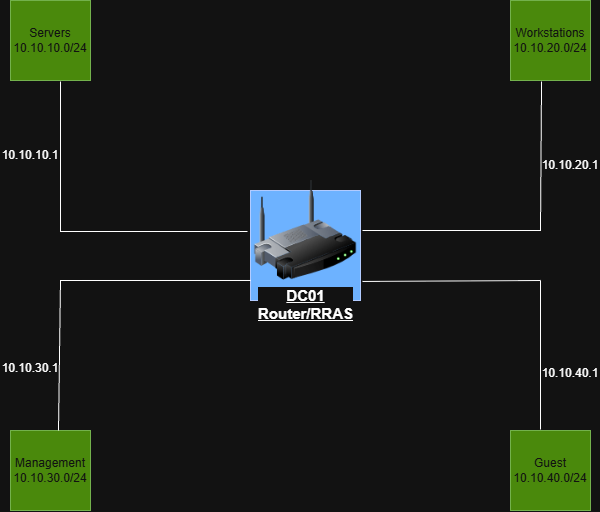
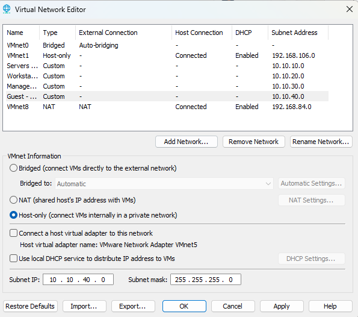
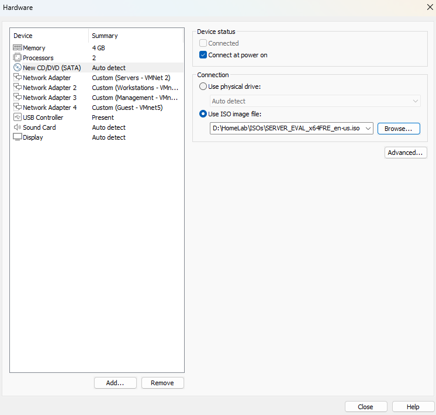
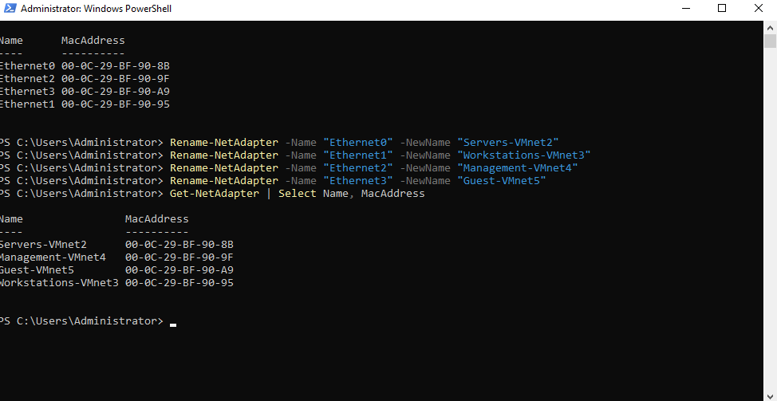
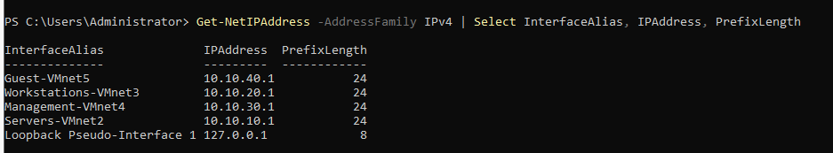
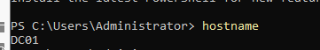

# Project 1 — Multi-Subnet Enterprise Network (v2)

> **Status: In progress.** Design, virtual networks, and DC01 build are complete. RRAS routing, connectivity testing, and firewall policy are being added next.
>
> This is a from-scratch rebuild (v2) done after earning CompTIA Network+. The original build is preserved under the `v1-archive` tag of this repository.

## Overview
A segmented enterprise network built in VMware Workstation Pro, isolating traffic into four zones — Servers, Workstations, Management, and Guest — with a central Windows Server acting as the router between them. This mirrors how real business networks are designed: instead of one flat network where every device can reach every other device, traffic between zones passes through a single controllable checkpoint where policy can be enforced.

## Architecture Diagram


*DC01 is a multi-homed router with one interface in each segment. Each interface address (.1) is the default gateway for the devices on that segment.*

## Objectives
- Design a private IP addressing scheme across 4 network segments
- Build an isolated virtual switch for each segment
- Build a multi-homed Windows Server to act as the router between segments (RRAS)
- Enforce firewall policy limiting which segments can reach which others
- Prove the design with real connectivity tests, not just configuration

## Tools & Technologies
- VMware Workstation Pro (host-only virtual networking)
- Windows Server 2022 Standard (Desktop Experience)
- RRAS — Routing and Remote Access Service *(upcoming)*
- RRAS IP Packet Filters *(upcoming)*
- draw.io (network diagram)

## IP Addressing Scheme
| Segment | VMware Network | Subnet | Gateway (DC01) |
|---|---|---|---|
| Servers | VMnet2 | 10.10.10.0/24 | 10.10.10.1 |
| Workstations | VMnet3 | 10.10.20.0/24 | 10.10.20.1 |
| Management | VMnet4 | 10.10.30.0/24 | 10.10.30.1 |
| Guest | VMnet5 | 10.10.40.0/24 | 10.10.40.1 |

Each /24 leaves 8 host bits (254 usable addresses). The third octet identifies the segment, which keeps the scheme easy to read. The network address (.0) and broadcast address (.255) are reserved in every subnet.

## DC01 Interface Mapping
| Windows NIC Name | VMware Adapter | VMnet | Segment | MAC Address | IP Address |
|---|---|---|---|---|---|
| Servers-VMnet2 | Network Adapter 1 / Ethernet0 | VMnet2 | Servers | 00:0C:29:BF:90:8B | 10.10.10.1/24 |
| Workstations-VMnet3 | Network Adapter 2 / Ethernet1 | VMnet3 | Workstations | 00:0C:29:BF:90:95 | 10.10.20.1/24 |
| Management-VMnet4 | Network Adapter 3 / Ethernet2 | VMnet4 | Management | 00:0C:29:BF:90:9F | 10.10.30.1/24 |
| Guest-VMnet5 | Network Adapter 4 / Ethernet3 | VMnet5 | Guest | 00:0C:29:BF:90:A9 | 10.10.40.1/24 |

## Build Process

### 1. Design the network before touching any software
Four non-overlapping /24 subnets from private (RFC 1918) address space, one per zone, drawn in draw.io first. Planning the addressing up front means every later problem is either a typo or a design flaw, and the diagram makes it easy to tell which.

### 2. Create the four virtual networks
In VMware's Virtual Network Editor, created VMnet2–VMnet5 as host-only networks with the subnets above and renamed each after its segment. VMware's local DHCP service was disabled on every network, and no host adapter was attached, so the lab is fully isolated from the host PC and addressing is controlled manually.

Each VMnet is a separate virtual switch — an isolated Layer 2 segment.



### 3. Build DC01
Created a Windows Server 2022 Standard (Desktop Experience) VM with 2 vCPUs, 4 GB RAM, and a 60 GB disk, with four network adapters, one attached to each VMnet. Desktop Experience was chosen deliberately to use the graphical AD, GPO, and DNS tools in later projects.



### 4. Match and rename the adapters
All four virtual NICs look identical inside Windows, so each one was matched to its VMnet by MAC address: the MAC listed under each adapter's Advanced settings in VMware was compared against `Get-NetAdapter` output in Windows. Each adapter was then renamed to a self-documenting name.

```powershell
Get-NetAdapter | Select Name, MacAddress

Rename-NetAdapter -Name "Ethernet0" -NewName "Servers-VMnet2"
Rename-NetAdapter -Name "Ethernet1" -NewName "Workstations-VMnet3"
Rename-NetAdapter -Name "Ethernet2" -NewName "Management-VMnet4"
Rename-NetAdapter -Name "Ethernet3" -NewName "Guest-VMnet5"
```



### 5. Assign static IP addresses
Each adapter received the .1 address for its subnet with a /24 prefix. **No default gateway was set on any adapter**, because DC01 is itself the gateway for every segment — it has nowhere further to forward unknown traffic.

```powershell
New-NetIPAddress -InterfaceAlias "Servers-VMnet2"      -IPAddress 10.10.10.1 -PrefixLength 24
New-NetIPAddress -InterfaceAlias "Workstations-VMnet3" -IPAddress 10.10.20.1 -PrefixLength 24
New-NetIPAddress -InterfaceAlias "Management-VMnet4"   -IPAddress 10.10.30.1 -PrefixLength 24
New-NetIPAddress -InterfaceAlias "Guest-VMnet5"        -IPAddress 10.10.40.1 -PrefixLength 24
```

Assigning an address to each adapter also gives DC01 a connected route to each subnet automatically, so it knows all four networks directly.



### 6. Rename the server
Renamed the computer to match the diagram.

```powershell
Rename-Computer -NewName "DC01" -Restart
```



### 7. Install and configure RRAS *(upcoming)*
### 8. Prove routing with a test VM *(upcoming)*
### 9. Implement firewall policy with RRAS packet filters *(upcoming)*
### 10. Validate every rule *(upcoming)*

## Problems Encountered & Fixes
- **VMware wizard detected the wrong operating system.** The New Virtual Machine wizard remembered the Windows 11 ISO from the previous build and labelled the new VM "Windows 11 x64," with the wrong name and folder. Fixed by choosing *I will install the operating system later*, setting the guest OS to Windows Server 2022, and attaching the Server 2022 ISO afterward in the hardware settings.
- **Windows adapter order did not match VMware adapter order.** `Get-NetAdapter` listed the adapters in a different order from the VMware adapter numbering, so counting down the list would have mapped them to the wrong segments. MAC address matching resolved it, and the adapters were renamed immediately to avoid repeating the exercise.

## Key Takeaways / Skills Demonstrated
*(To be completed when the project is finished.)*
- Private IP addressing design (RFC 1918) and subnetting across multiple segments
- Layer 2 segmentation with isolated virtual switches versus Layer 3 addressing and gateways
- Identifying network interfaces by MAC address and documenting an interface-to-segment mapping
- Building a multi-homed Windows Server for routing

## Current Scope Note
True 802.1Q VLAN tagging is not used here. VMware Workstation does not support VLAN trunking, so this design uses four separate virtual switches rather than one trunked switch. Real VLAN tagging will be implemented in Project 5 using pfSense.
