# Project 2: Active Directory

> **Status: Complete.** Domain controller promoted, client joined, OU structure and service accounts built, three GPOs enforced and verified on the client, and password-reset rights delegated to a helpdesk group with allowed and denied cases tested.
>
> This is a v2 rebuild on the v2 network from [Project 1](../01-enterprise-network/README.md). The original build is archived under the git tag `v1-archive`.

## Overview

Active Directory is how most Windows-based companies centrally manage who can sign in, what settings every machine must follow, and who is allowed to administer what. This project turns DC01, the 4-NIC router built in Project 1, into a domain controller for `corp.local`, joins a Windows 11 client from a separate network segment, and builds the structure a real helpdesk team would work in: OUs, security groups, service accounts, Group Policy, and least-privilege delegation instead of handing out Domain Admin.

## Architecture Diagram

The network underneath this project is the one built in Project 1. DC01 is both the router between the four segments and, now, the domain controller and DNS server for `corp.local`.

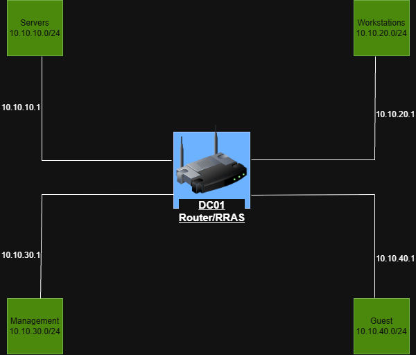

| Item | Value |
|---|---|
| Domain | `corp.local` (NetBIOS `CORP`), functional level Windows Server 2016 |
| Domain controller | DC01, `10.10.10.1` (Servers segment), AD DS + DNS |
| Client | WS01, Windows 11 Pro, `10.10.20.50/24` on Workstations (VMnet3), gateway and DNS `10.10.20.1` (DC01's Workstations NIC) |
| Share | `\\DC01\IT` (`C:\Shares\IT`) |

## Objectives

- Promote DC01 to a domain controller and create the `corp.local` forest
- Make DNS work correctly for a domain controller that has four network cards
- Join a client on a different, routed network segment to the domain
- Build an OU structure, security group, test users and service accounts
- Create three GPOs and prove each one applies on the client
- Delegate a single task (password resets) on one OU to a security group, and test both the allowed and denied cases

## Tools & Technologies

- Windows Server 2022 (DC01): Active Directory Domain Services, DNS Server, Routing and Remote Access (from Project 1)
- Windows 11 Pro 25H2 (WS01) with a virtual TPM
- VMware Workstation Pro
- Active Directory Users and Computers (ADUC), Group Policy Management Console (GPMC), DNS Manager
- Remote Server Administration Tools (RSAT) on the client
- PowerShell: `Set-DnsClientServerAddress`, `Set-DnsClient`, `Get-ADDomain`, `New-NetIPAddress`, `Rename-Computer`, `New-SmbShare`, `Add-WindowsCapability`
- Diagnostic tools: `gpupdate`, `gpresult`, `nslookup`, `net accounts`

## Build Process

### 1. Prepare DC01

Before changing anything, take a VMware snapshot of DC01 so the working Project 1 router state can be restored if the promotion goes wrong. Then point DC01's own DNS client at itself. A domain controller runs the DNS records the domain depends on, so it must look itself up for them rather than ask an outside server. This is set on one NIC (the Servers NIC) and DC01 uses it for all its lookups.

```powershell
Set-DnsClientServerAddress -InterfaceAlias "Servers-VMnet2" -ServerAddresses 10.10.10.1
Get-DnsClientServerAddress -InterfaceAlias "Servers-VMnet2" -AddressFamily IPv4
```

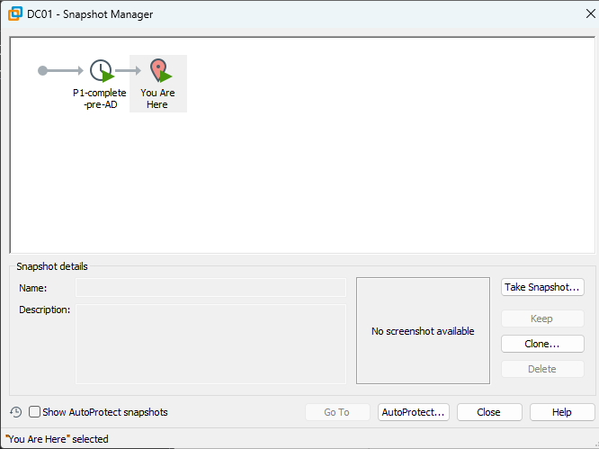
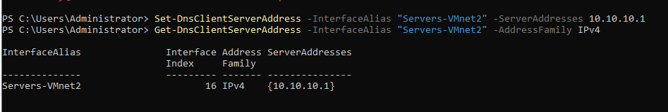

### 2. Install AD DS and promote DC01

Installing the AD DS role only adds the software. Promotion is what creates the domain. A new forest named `corp.local` was created with DNS and Global Catalog enabled, and a DSRM (recovery) password set and stored in a password manager, not in the repo. The "delegation for this DNS server cannot be created" warning is expected on a lab domain with no parent DNS zone and was safe to ignore. DC01 restarted automatically and the domain was confirmed afterwards.

```powershell
Get-ADDomain | Select-Object Name, DNSRoot, DomainMode
```

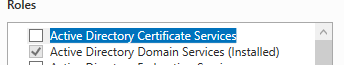
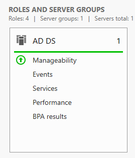
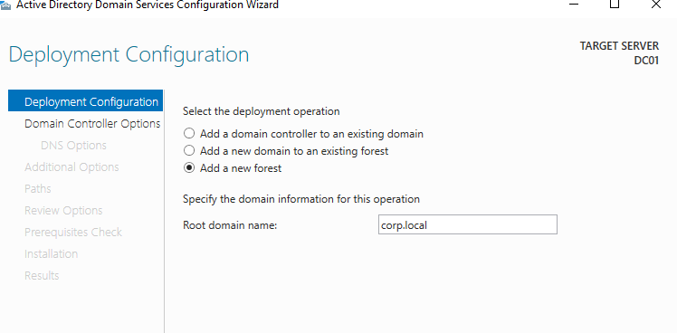
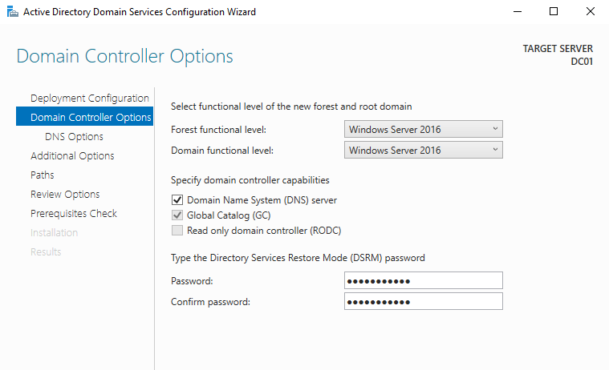
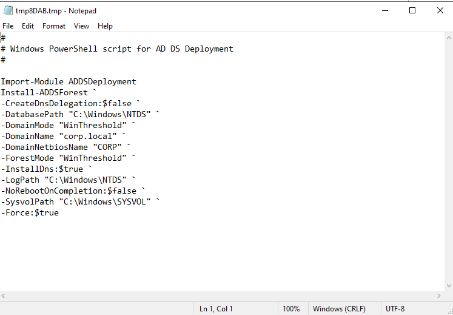
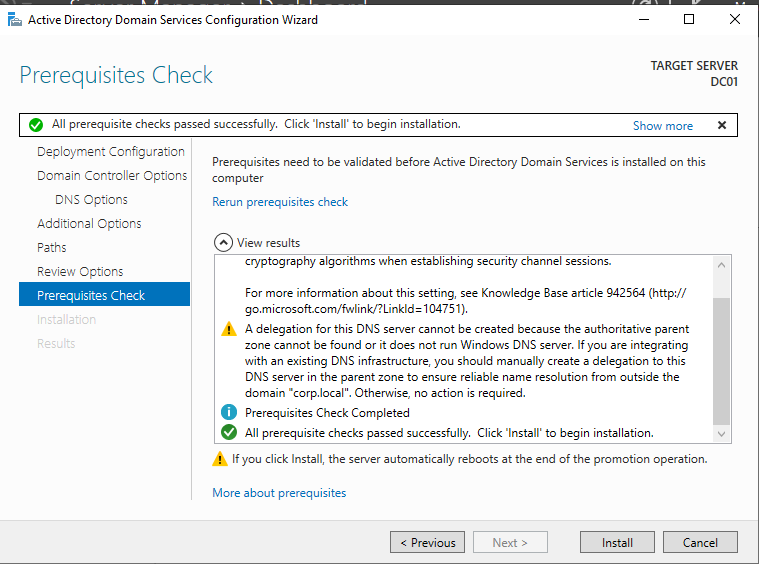
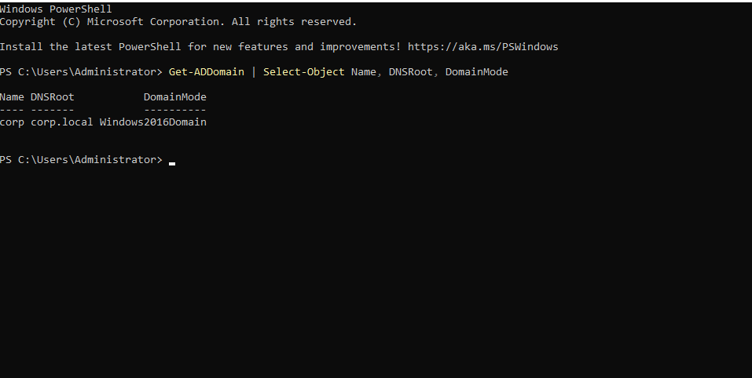

### 3. Fix DNS for a multi-homed domain controller

DC01 has four network cards, and a domain controller registers a DNS record for every IP it has. Left alone, `DC01.corp.local` would resolve to four addresses, and a client could be handed one on a segment it can't reach. The Workstations, Management and Guest NICs were set not to register in DNS, and the stale A records were deleted from the `corp.local` zone, leaving only `10.10.10.1`. The `_msdcs`, `_sites`, `_tcp` and `_udp` folders were left untouched because AD uses those records to locate the domain controller.

```powershell
Set-DnsClient -InterfaceAlias "Workstations-VMnet3" -RegisterThisConnectionsAddress $false
Set-DnsClient -InterfaceAlias "Management-VMnet4" -RegisterThisConnectionsAddress $false
Set-DnsClient -InterfaceAlias "Guest-VMnet5" -RegisterThisConnectionsAddress $false
Get-DnsClient | Select-Object InterfaceAlias, RegisterThisConnectionsAddress
```

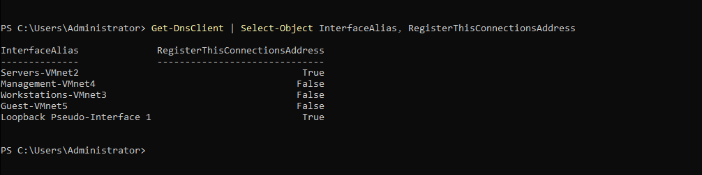
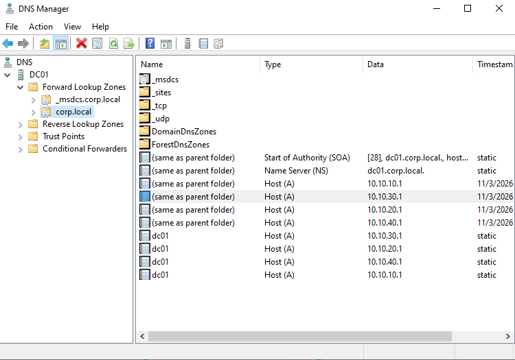
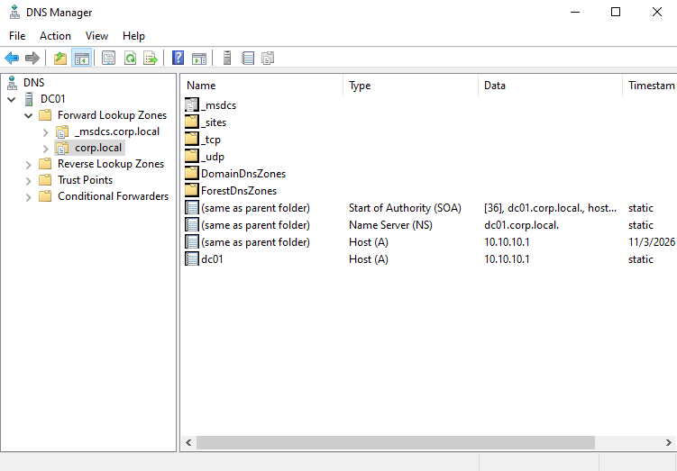

### 4. Build WS01 and test the network before joining

WS01 is a Windows 11 Pro VM on VMnet3 (Workstations): 2 vCPU, 4 GB RAM, 60 GB disk, UEFI with a virtual TPM. It has no DHCP, so it was given a static address, with its gateway and DNS pointing at DC01's Workstations NIC. Before joining, connectivity and DNS were tested across the routed segment, so a failed join couldn't be a network problem.

```powershell
New-NetIPAddress -InterfaceAlias "Ethernet0" -IPAddress 10.10.20.50 -PrefixLength 24 -DefaultGateway 10.10.20.1
Set-DnsClientServerAddress -InterfaceAlias "Ethernet0" -ServerAddresses 10.10.20.1
Get-NetIPConfiguration
ping 10.10.20.1
nslookup corp.local
```

`nslookup corp.local` returned only `10.10.10.1`, which also confirms the DNS cleanup in step 3 worked. The "Server: UnKnown" and timeout line before the answer is the tool's reverse lookup of the DNS server's own IP failing because no reverse zone exists yet. It is harmless.

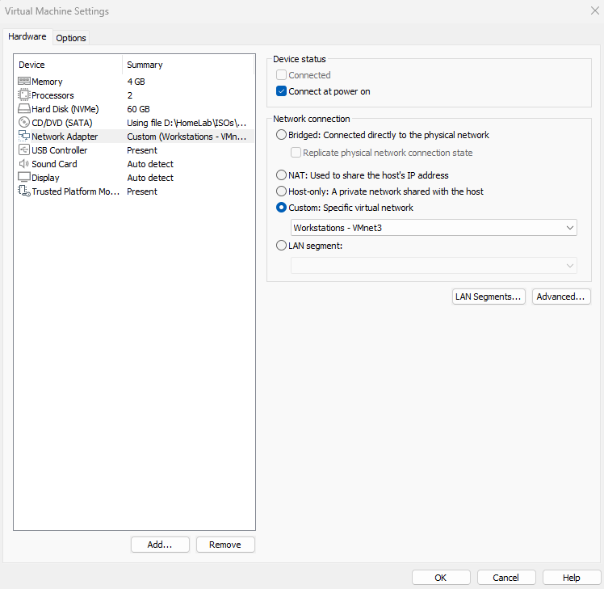
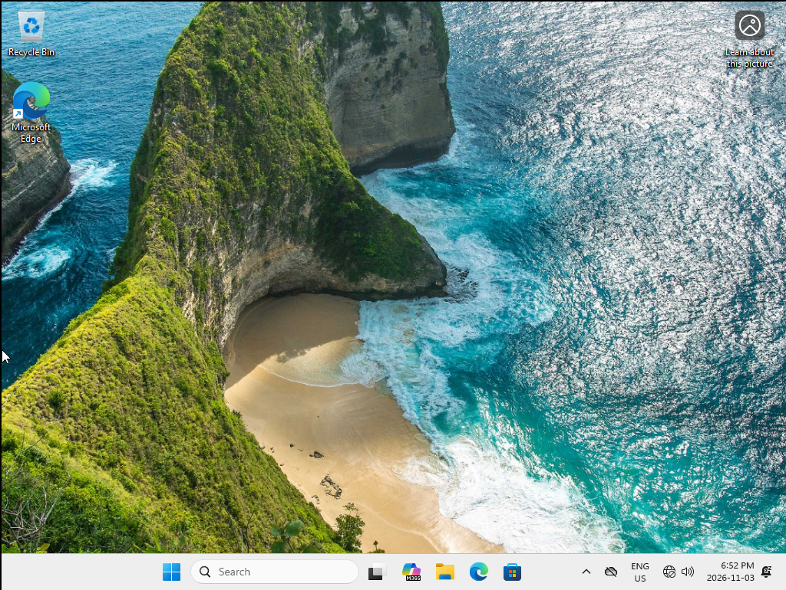
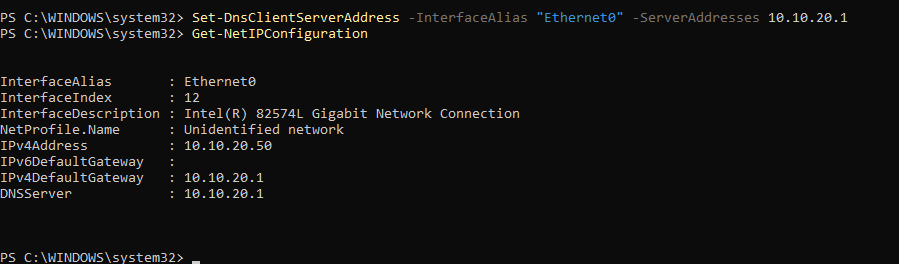
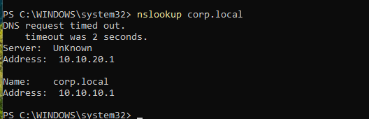

### 5. Join WS01 to the domain

Joining creates a computer account for WS01 in AD and makes it trust DC01 for sign-ins and policy. Joining is a privileged action, so the join asks for domain credentials with permission to add computers. After the restart, WS01 was signed in with a domain account and the computer object was confirmed in ADUC. The computer name hadn't been applied during setup, so it first joined as an auto-generated `DESKTOP-` name and was renamed (see Problems Encountered).

```powershell
Rename-Computer -NewName "WS01" -DomainCredential CORP\Administrator -Restart
whoami
hostname
```

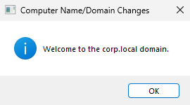
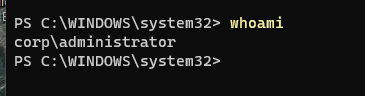
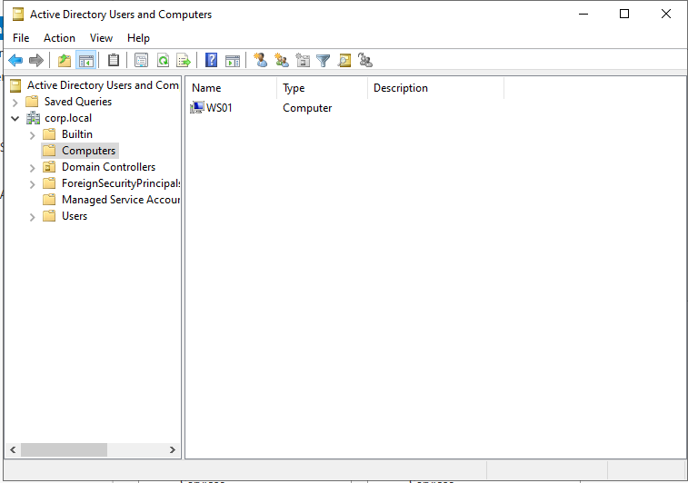

### 6. OUs, security group, users and service accounts

OUs are folders in AD used to apply Group Policy and delegate control. They are unrelated to network segments: a user in an OU can sit on any segment. Security groups hold permissions by role, which is a separate job from OUs.

```
corp.local
├── Departments
│   ├── IT  (Helpdesk-Group, tuser, luser)
│   ├── Sales
│   ├── Marketing
│   └── Finance
├── Management
└── Service Accounts  (svc-backup, svc-wazuh)
```

- `Helpdesk-Group` is a Global security group. `tuser` (the helpdesk technician) is its only member. `luser` is deliberately not a member, so it can act as the ordinary user whose password gets reset in the delegation test.
- `svc-backup` and `svc-wazuh` are service accounts. They are set to "password never expires" and "user cannot change password", because an expired password would silently break whatever service uses the account. They have no permissions beyond the default yet and will be granted only what they need in later projects.

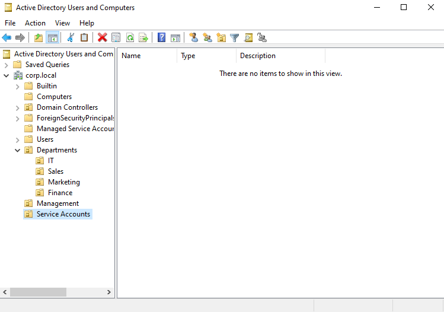
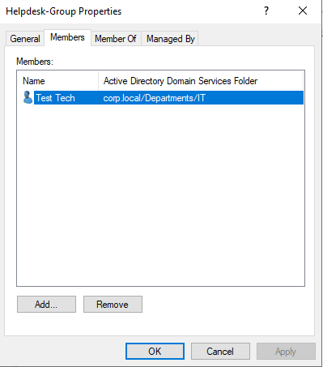
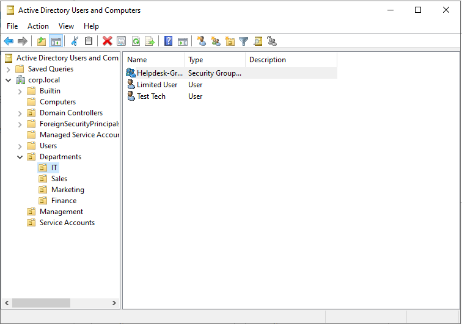
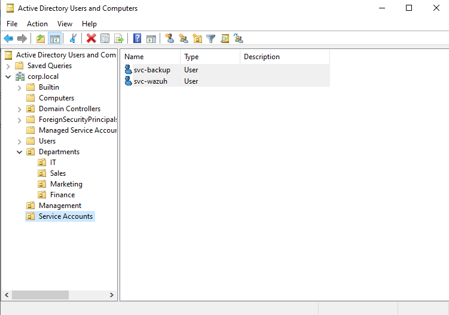

### 7. Group Policy

A GPO is a bundle of settings DC01 pushes to the computers and users under the place it is linked. Three were built.

| GPO | Linked to | What it does |
|---|---|---|
| Domain Password Policy | `corp.local` (domain) | Minimum 12 characters, complexity required, maximum age 90 days, minimum age 1 day, 24 passwords remembered |
| Disable USB Storage | IT OU | User Configuration, Removable Storage Access: "All Removable Storage classes: Deny all access" |
| Map IT Shared Drive | IT OU | Maps `\\DC01\IT` to `I:` ("IT Share") |

- Password policy only takes effect when linked at the domain level, not to an OU. Its link order was checked so it takes precedence over `Default Domain Policy`.
- The USB and drive GPOs use the **User Configuration** side, so they follow `tuser` and `luser` to whichever machine they sign in on, and WS01 did not have to be moved into the IT OU.
- The shared folder behind the drive map was created on DC01:

```powershell
New-Item -Path C:\Shares\IT -ItemType Directory
New-SmbShare -Name "IT" -Path C:\Shares\IT -ChangeAccess "CORP\Domain Users"
Get-SmbShare -Name IT
```

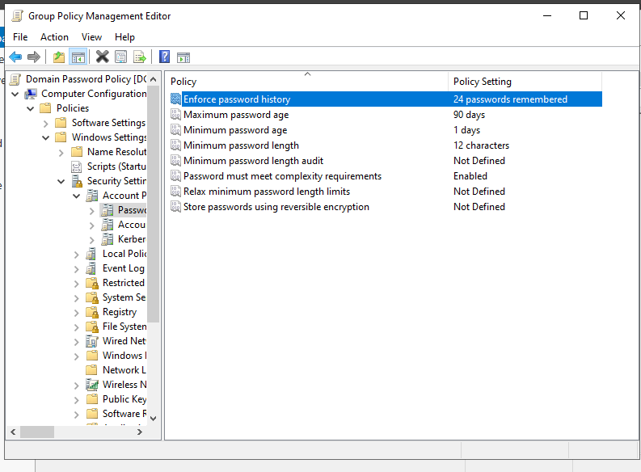
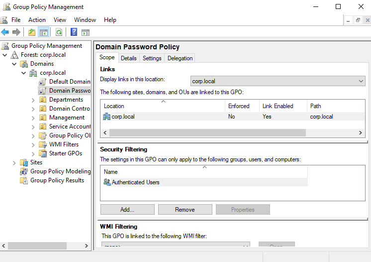
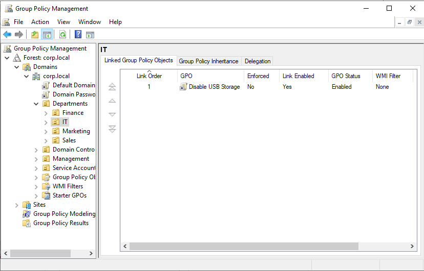
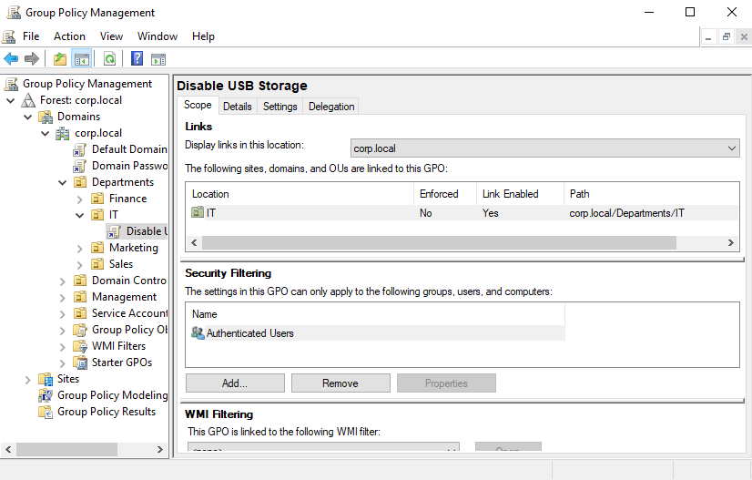
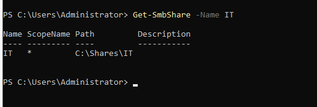
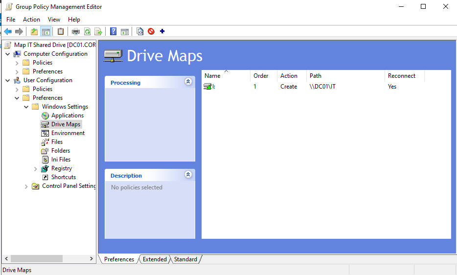
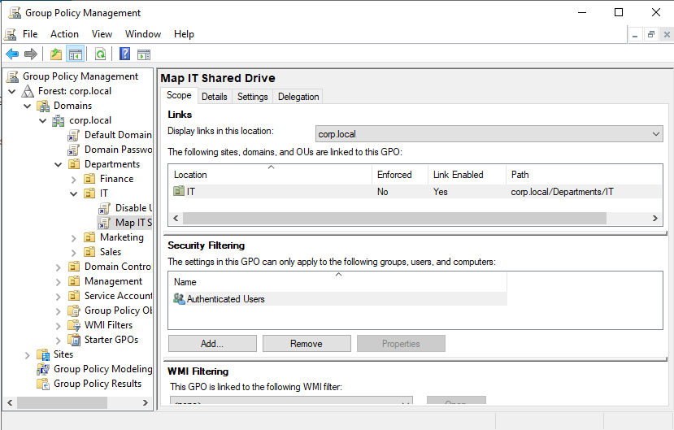

### 8. Verify the GPOs on WS01

Group Policy is applied on the client, so the proof lives on the client. WS01 was signed in as `CORP\luser` (a user in the IT OU). In normal operation nobody runs these commands: policy applies at sign-in and about every 90 minutes. They are here only to test it immediately.

```powershell
gpupdate /force
gpresult /r /scope user
net accounts /domain
```

`gpresult` listed both IT GPOs under Applied Group Policy Objects, `net accounts /domain` showed the new password rules, and the `I:` drive appeared in File Explorer. Settings reports for all three GPOs are included below.

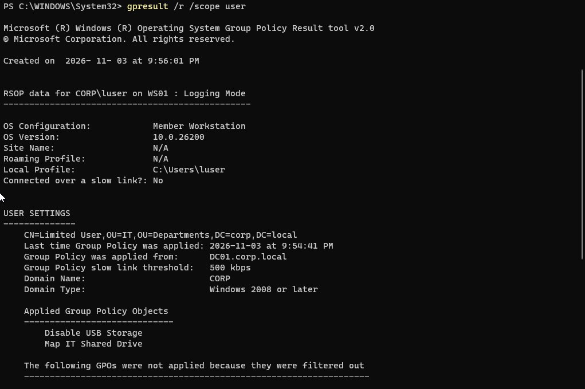
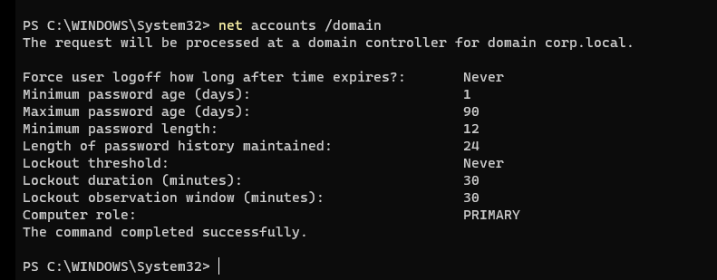
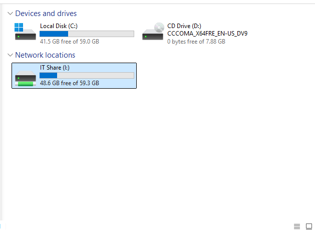
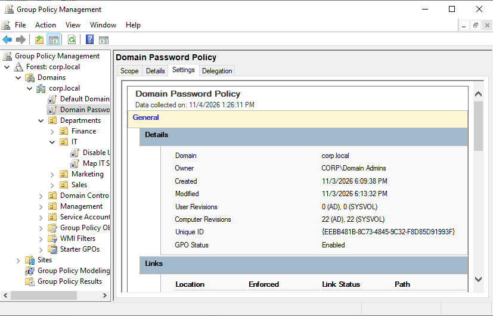
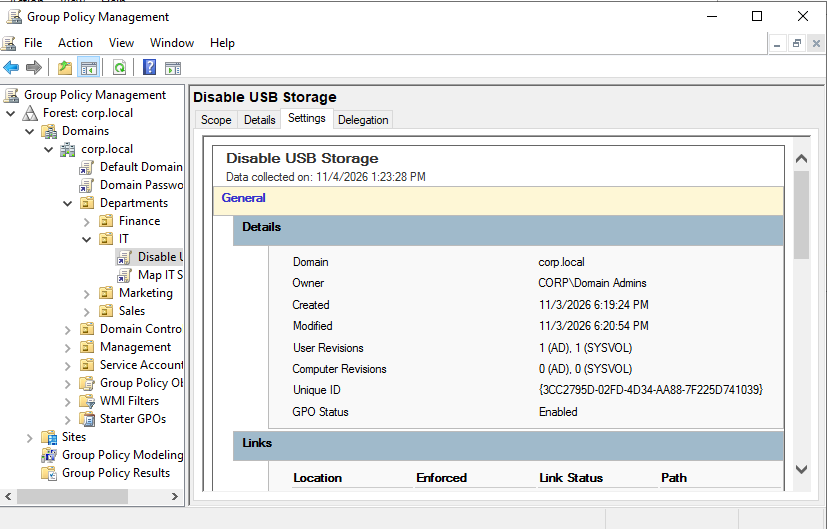
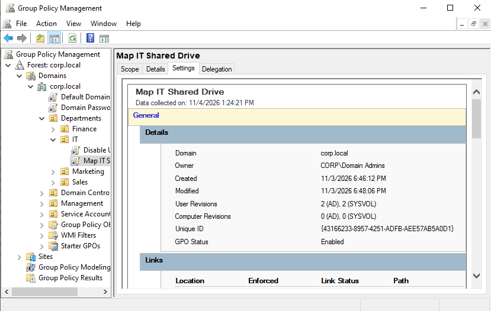

### 9. Delegate password resets to Helpdesk-Group

Delegation gives a group exactly one permission on exactly one OU. The common mistake is making helpdesk staff Domain Admins so they can reset passwords, which gives them control of the whole domain. Instead, the Delegation of Control wizard was run on the **IT OU** granting `Helpdesk-Group` "Reset user passwords and force password change at next logon". That covers user accounts inside the IT OU only. The resulting permission was confirmed in the OU's advanced security settings.

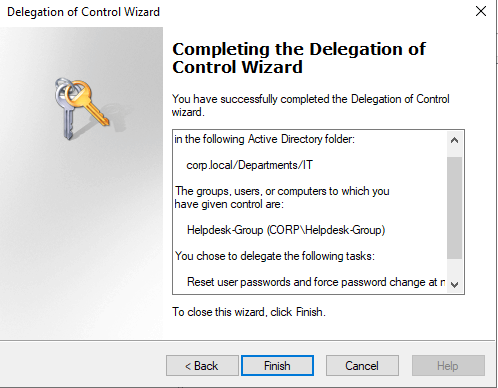
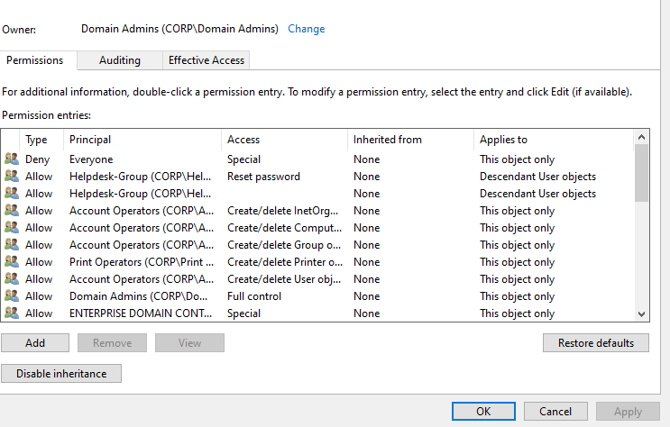

### 10. Test the delegation as the helpdesk technician

To test as `tuser` from WS01, RSAT had to be installed on the client. WS01 has no internet, so a NAT adapter was attached temporarily, RSAT was installed, and the adapter was then removed to keep the lab isolated.

```powershell
Get-WindowsCapability -Online -Name "Rsat.ActiveDirectory*" | Add-WindowsCapability -Online
Get-WindowsCapability -Online -Name "Rsat.ActiveDirectory*"
```

Signed in as `CORP\tuser`, ADUC (`dsa.msc`) was opened and two cases were tested:

| Test | Expected | Result |
|---|---|---|
| Reset `luser`'s password (IT OU) | Allowed | Succeeded |
| Create a new user in the IT OU | Denied | The **New** menu was not offered, because `tuser` has no create rights |

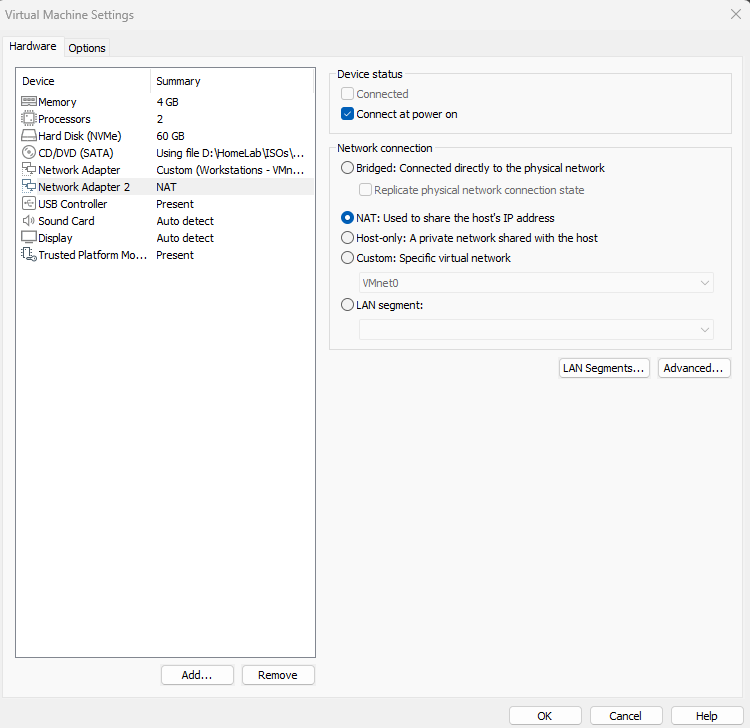
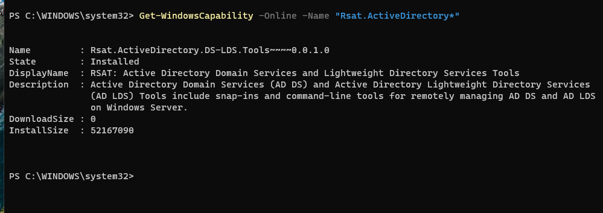
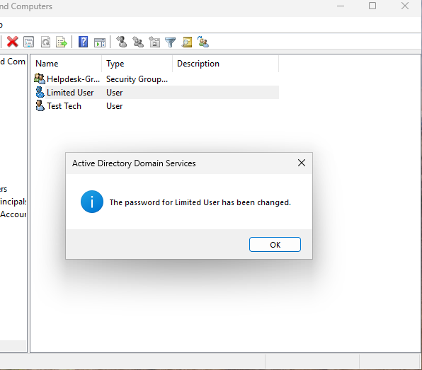
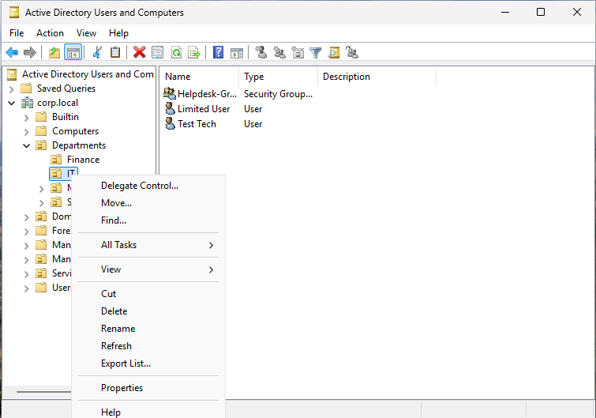

## Problems Encountered & Fixes

| Problem | Cause | Fix |
|---|---|---|
| DC01 would advertise four IPs in DNS | A domain controller registers every NIC's address, and DC01 has four NICs | Disabled DNS registration on the Workstations, Management and Guest NICs and deleted the stale A records, leaving `10.10.10.1` only. Confirmed with `nslookup corp.local` from WS01 |
| Could not add a TPM to the WS01 VM (Finish button greyed out) | VMware requires the VM to be encrypted and use UEFI before it allows a virtual TPM, and Windows 11 needs a TPM | Encrypted the VM (config files only), confirmed UEFI, then added the Trusted Platform Module |
| Windows 11 setup stuck on "Let's connect you to a network" | Setup requires internet and WS01 is on an isolated segment with DHCP off | At that screen, `Shift+F10` then `oobe\bypassnro` adds an "I don't have internet" option, so a local account can be created |
| WS01 joined the domain as `DESKTOP-xxxx` instead of `WS01` | The device name entered during setup was not applied | `Rename-Computer -NewName "WS01" -DomainCredential CORP\Administrator -Restart`. A domain-joined rename also updates the computer account in AD, so no leftover object remained |
| RSAT would not install on the isolated client | RSAT is downloaded from Microsoft; WS01 had no internet. After a temporary NAT adapter was added, the first attempt used a mistyped capability name and installed nothing (state `NotPresent`), and later attempts were rolled back by background Windows Update reboots | Piped the exact capability object into `Add-WindowsCapability` instead of retyping the name, allowed Windows Update to finish first, then installed. Removed the NAT adapter afterwards |
| `New-NetIPAddress` returned "Access is denied" | PowerShell was not running as administrator | Reopened PowerShell with Run as administrator |

## Known Limitations

- DC01 is both the router and the domain controller. This suits a lab but a production network would normally separate those roles.
- The `\\DC01\IT` share grants Change access to all Domain Users for simplicity. A production share would be restricted to IT staff with tighter folder permissions.
- The USB policy was verified through `gpresult`, which listed it as applied. It was not tested with a physical USB device.
- Delegation was tested inside the IT OU (reset allowed, create denied). A reset against a user in another OU was not tested.
- No reverse lookup zone has been created, which is why `nslookup` prints a timeout and `Server: UnKnown` before answering.

## Key Takeaways / Skills Demonstrated

- **Active Directory Domain Services:** promoted a domain controller, created a forest, joined and renamed a domain client
- **DNS for AD:** configured a domain controller's own DNS, and diagnosed and fixed a multi-homed DC registering unreachable addresses
- **Group Policy:** built, linked and verified domain-level and OU-level GPOs; understood link order and which settings only work at the domain level
- **Least-privilege administration:** delegated one task on one OU to a security group instead of granting Domain Admin, and tested both the allowed and denied cases
- **Account management:** OU design, security groups, helpdesk password resets, and correct handling of service accounts
- **Troubleshooting:** diagnosed and documented DNS registration, VM TPM requirements, offline Windows 11 setup, and Windows Feature-on-Demand install failures
- **Verification mindset:** every change was proven with a before/after check (`gpresult`, `nslookup`, `net accounts`, permission tests) and captured in screenshots

## Next

Project 3 builds the Linux services (DNS, DHCP, NTP and web) that this domain relies on, and Project 5 replaces the stateless RRAS filtering with a stateful pfSense firewall and real 802.1Q VLANs.
