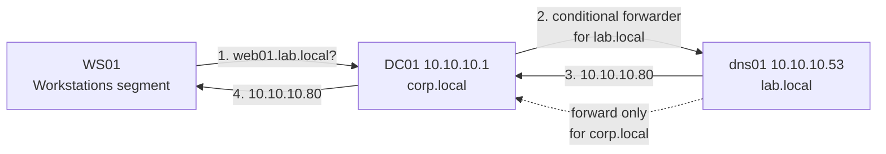
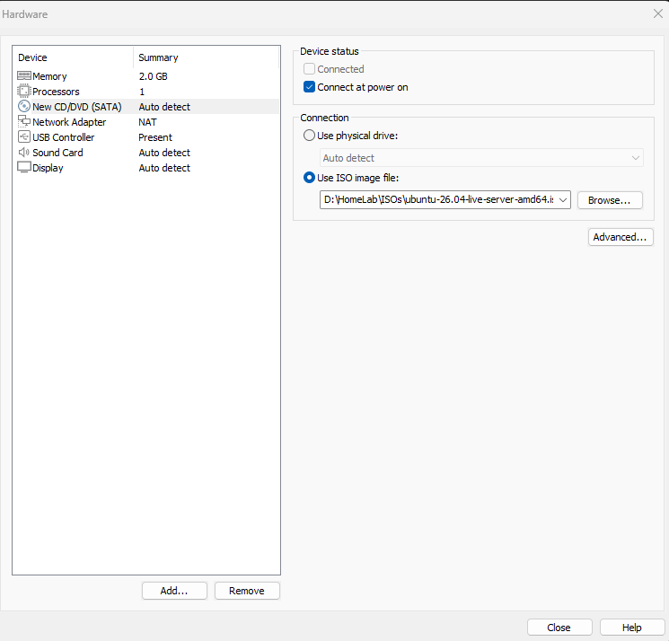
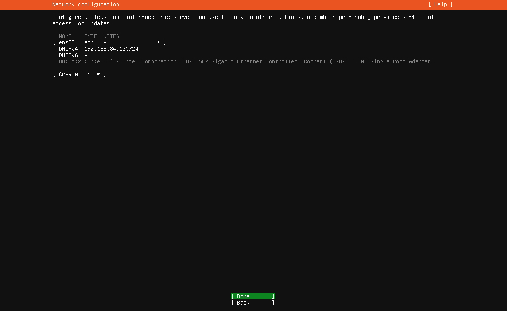
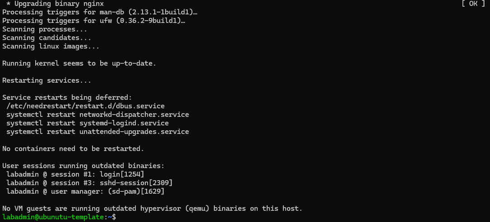
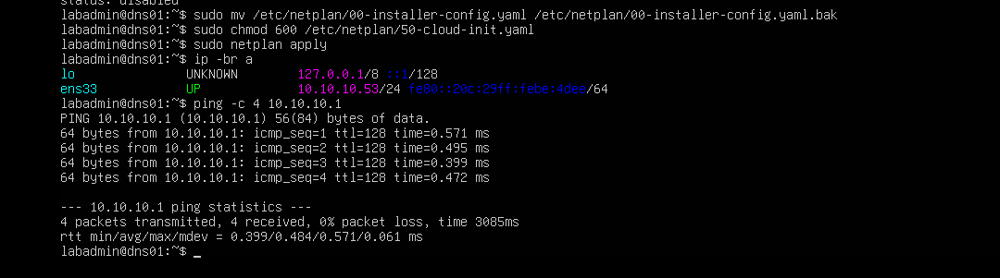
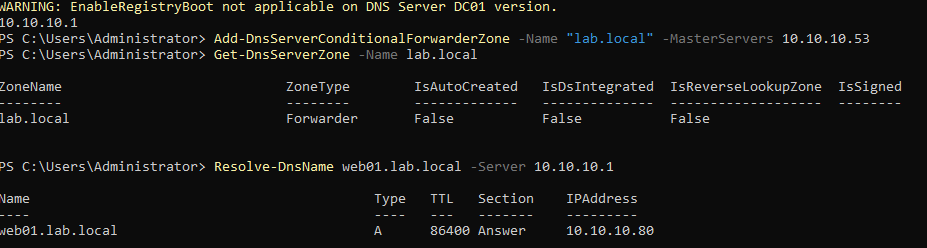
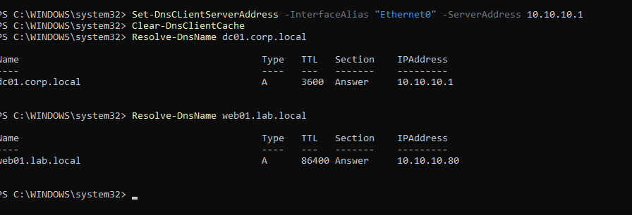

# Project 3: Linux Services Network


DNS, DHCP, NTP and a web server on Ubuntu Server, joined to the existing Windows environment from Projects 1 and 2. The goal is two DNS servers (Microsoft DNS on DC01, BIND9 on `dns01`) that answer each other's questions, so a Windows client can find a Linux server by name and the other way round.

> Work in progress. Sections are added as each service is built and tested.

## Quick reference

### Servers and addresses

All four Linux servers sit on the **Servers** segment (`10.10.10.0/24`, VMnet2), with static addresses. DC01 is the gateway at `10.10.10.1`.

| Host | Full name | IP address | Segment | Role | Status |
|---|---|---|---|---|---|
| DC01 | `dc01.corp.local` | `10.10.10.1` | Servers (routes all segments) | Domain controller, DNS for `corp.local`, RRAS router | Built (Projects 1-2) |
| `dns01` | `dns01.lab.local` | `10.10.10.53` | Servers | BIND9 DNS, authoritative for `lab.local` | Built |
| `dhcp01` | `dhcp01.lab.local` | `10.10.10.67` | Servers | DHCP server | Planned |
| `ntp01` | `ntp01.lab.local` | `10.10.10.123` | Servers | NTP time server (chrony) | Planned |
| `web01` | `web01.lab.local` | `10.10.10.80` | Servers | Nginx web server | Planned |
| WS01 | `ws01.corp.local` | `10.10.20.x` | Workstations | Windows 11 client, domain-joined | Built (Project 2) |

`lab.local` records for `dhcp01`, `ntp01` and `web01` already exist in the zone file, so the names resolve as soon as those servers are built.

### Two DNS domains

A domain name is a label for a group of names. It is separate from the network segment a machine sits on.

| Domain | Held by | Contains | Where its machines are |
|---|---|---|---|
| `corp.local` | DC01 (Microsoft DNS, Active Directory) | The Windows side: DC01, WS01, users | Spread across segments |
| `lab.local` | `dns01` (BIND9) | The Linux servers | All on the Servers segment |

Active Directory manages `corp.local` machines only. The Linux servers are not domain-joined, so they are configured individually over SSH.

### How a name is resolved



| Question | Asked to | What happens |
|---|---|---|
| `web01.lab.local` | `dns01` | Answered from its own `lab.local` zone file |
| `dc01.corp.local` | `dns01` | `dns01` forwards to DC01 and returns its answer |
| `web01.lab.local` | DC01 | DC01 forwards to `dns01` using a conditional forwarder |

## Build progress

- [x] Ubuntu Server template built, packages preinstalled, snapshot `template-ready`
- [x] `dns01`: static IP on the Servers segment, reachable from DC01
- [x] BIND9 configured: `lab.local` zone, `corp.local` forwarded to DC01
- [x] DC01 conditional forwarder for `lab.local`
- [x] Test from WS01 across segments (`web01.lab.local` and `dc01.corp.local` both resolve)
- [ ] `dhcp01` with a DHCP relay agent on DC01
- [ ] `ntp01` with DC01 syncing time from it
- [ ] `web01`, resolved by name through `dns01`
- [ ] Full write-up, screenshots and "Problems Encountered" section

## Build process

### 1. Ubuntu Server template

Building each Linux server from scratch would repeat the same install four times, so one template VM is built once and cloned. The template, `ubuntu-template`, runs Ubuntu Server 26.04 with 1 vCPU and 2 GB RAM. It was built on a **NAT** adapter, because package installs need internet and the lab segments have none. The packages for the planned roles (BIND9, chrony, Nginx) were installed there, and the role services were then **disabled**, so a clone only runs the one service it is meant for. With the VM powered off, a snapshot named `template-ready` was taken to clone from.






### 2. Clone `dns01` and put it on the Servers segment

`dns01` is a full clone of `template-ready`. A clone starts with the template's name and network settings, so it was given its own identity while still on NAT (so SSH kept working), then powered off before being moved to the lab network. The static address only works on VMnet2, so applying it on NAT would cut the connection.

```bash
sudo hostnamectl set-hostname dns01
sudo sed -i 's/<old-template-name>/dns01/g' /etc/hosts
```

The network config is in [`configs/dns01/50-cloud-init.yaml`](configs/dns01/50-cloud-init.yaml): static `10.10.10.53/24`, default gateway DC01 (`10.10.10.1`), DNS DC01. After powering off, the adapter was changed to **Custom: Servers - VMnet2** and memory to 1 GB.


The clone booted with no IPv4 address because the installer's `00-installer-config.yaml` was still in `/etc/netplan` (see Problems below). It was moved aside and the config applied:

```bash
sudo mv /etc/netplan/00-installer-config.yaml /etc/netplan/00-installer-config.yaml.bak
sudo chmod 600 /etc/netplan/50-cloud-init.yaml
sudo netplan apply
ip -br a
ping -c 4 10.10.10.1
```

`dns01` shows `10.10.10.53/24` and reaches DC01 with 0% packet loss.



### 3. Configure BIND9 on `dns01`

**BIND9** is the DNS server software. `dns01` is the authoritative server for `lab.local` and forwards `corp.local` questions to DC01. Three files make that up (all in [`configs/dns01/`](configs/dns01/)):

- `named.conf.options` sets BIND to listen only on `10.10.10.53` and localhost, answer only the lab networks (`10.10.0.0/16`), and allow recursion for them only. DNSSEC validation is off because the lab has no internet to validate against.
- `named.conf.local` declares the zones: `lab.local` as `primary`, and `corp.local` as a `forward only` zone pointing at DC01 (`10.10.10.1`).
- `db.lab.local` holds the records: `dns01`, `dhcp01`, `ntp01` and `web01`. The records for servers not built yet are included so their names resolve as soon as they exist.

Both the configuration and the zone file were checked before starting the service. No output from `named-checkconf` means the syntax is valid:

```bash
sudo named-checkconf
sudo named-checkzone lab.local /etc/bind/db.lab.local
```


The service was disabled in the template, so it was enabled and started, then tested with `dig`. The first lookup is answered from the local zone, and the second is forwarded to DC01:

```bash
sudo systemctl enable --now named
dig @10.10.10.53 web01.lab.local +short
dig @10.10.10.53 dc01.corp.local +short
```


### 4. Make DC01 return a single address

The `dc01.corp.local` lookup returned four addresses (one per DC01 NIC), even though the Project 2 cleanup had removed them. Turning off DNS registration on the NICs was not enough: the **DNS Server service** itself registers every address it listens on. DC01's DNS server was restricted to listen only on its Servers address, then the stale records were checked after a service restart:

```powershell
dnscmd /ResetListenAddresses 10.10.10.1
Restart-Service DNS
Get-DnsServerSetting -All | Select-Object -ExpandProperty ListeningIPAddress
Get-DnsServerResourceRecord -ZoneName corp.local -Name DC01 -RRType A
```

Only `10.10.10.1` remains after a second restart.


### 5. Conditional forwarder on DC01

The other direction: DC01 has to know where to send `lab.local` questions. A conditional forwarder tells DC01 "for names ending in `lab.local`, ask `dns01`". Without it Windows machines cannot find the Linux servers.

```powershell
Add-DnsServerConditionalForwarderZone -Name "lab.local" -MasterServers 10.10.10.53
Get-DnsServerZone -Name lab.local
Resolve-DnsName web01.lab.local -Server 10.10.10.1
```

`lab.local` shows as a `Forwarder` zone, and DC01 resolves `web01.lab.local` to `10.10.10.80` through `dns01`.



### 6. Test from WS01 across segments

WS01 sits on the Workstations segment, so this tests the whole chain: WS01 asks DC01, DC01 forwards to `dns01`, and the answer returns. WS01 first failed with a timeout, because it used DC01's Workstations address (`10.10.20.1`) for DNS, and DC01's DNS now only answers on `10.10.10.1`. WS01's DNS server was changed (this needs an elevated PowerShell):

```powershell
Set-DnsClientServerAddress -InterfaceAlias "Ethernet0" -ServerAddresses 10.10.10.1
Clear-DnsClientCache
Resolve-DnsName dc01.corp.local
Resolve-DnsName web01.lab.local
```

`dc01.corp.local` resolves to `10.10.10.1` and `web01.lab.local` to `10.10.10.80`.



## Problems Encountered & Fixes

| Problem | Cause | Fix |
|---|---|---|
| SSH to the template: "Connection refused" | `openssh-server` was not installed. Ubuntu 26.04 uses socket activation (`ssh.socket`), so `ssh.service` showing inactive is normal once it is installed | `sudo apt install -y openssh-server`, then retry |
| Clone still showed the template's name in `/etc/hosts` after `hostnamectl set-hostname dns01` | `hostnamectl` does not edit `/etc/hosts`, and the template name had been typed as `ubunutu-template`, so a `sed` for the correct spelling matched nothing | `cat /etc/hosts`, then `sudo sed -i 's/ubunutu-template/dns01/g' /etc/hosts`. Read the file before assuming a replacement worked |
| Netplan file came out with no indentation, capitalised keys and missing spaces | Typing a multi-line heredoc into the VMware console mangled the input. YAML is case- and indentation-sensitive | Wrote the file with a one-line `printf '...\n...' \| sudo tee`, pasted over SSH, then confirmed with `cat` before powering off |
| Pasted command failed with `/dev/null~: Permission denied` | Right-click paste into Windows PowerShell appended a stray `~` (bracketed-paste artefact) | Press Backspace once to remove the `~` before Enter. Later config files were typed in `nano` over SSH from DC01 |
| Clone booted on VMnet2 with no IPv4 address although `50-cloud-init.yaml` held the correct static config | A second file, `00-installer-config.yaml`, set `ens33` to DHCP and matched the template's MAC address. Netplan merges all files, so the merged definition never matched the clone's NIC. cloud-init was disabled and was not the cause | Diagnosed with `ls /etc/netplan`, `sudo cat /etc/netplan/*.yaml` and `cloud-init status`. Moved the installer file aside, `chmod 600` on the remaining file, `sudo netplan apply`. Verified `10.10.10.53/24` and a ping to DC01 |
| `dc01.corp.local` returned four IPs when queried through `dns01` | DC01's DNS Server service re-registered every NIC's address after the Project 2 cleanup, even with NIC registration off | Restricted the DNS server to listen only on `10.10.10.1` (`dnscmd /ResetListenAddresses 10.10.10.1`, restart DNS) and confirmed only `10.10.10.1` remained after a second restart |
| WS01 lookups timed out right after that change | WS01's DNS server was DC01's Workstations address (`10.10.20.1`), which DC01's DNS stopped answering on | `Get-DnsClientServerAddress` on WS01 showed it. Pointed WS01 at `10.10.10.1` with `Set-DnsClientServerAddress -InterfaceAlias "Ethernet0" -ServerAddresses 10.10.10.1` |
| `Set-DnsClientServerAddress` failed with "Access to a CIM resource was not available" | PowerShell was not elevated; WS01 was signed in as a standard user | Opened PowerShell as administrator and supplied `CORP\Administrator` credentials |

Notes:
- Do not run `netplan apply` while the VM is on NAT. The static `10.10.10.x` address only works on VMnet2 and it cuts the SSH session. Write the file, power off, switch the adapter, then boot.
- Every clone from `template-ready` carries the installer's `00-installer-config.yaml`. Move it aside on each clone before setting the static IP.

