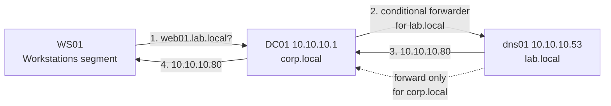

# Project 3: Linux Services Network

DNS, DHCP, NTP and a web server on Ubuntu Server, joined to the existing Windows environment from Projects 1 and 2. The goal is two DNS servers (Microsoft DNS on DC01, BIND9 on `dns01`) that answer each other's questions, so a Windows client can find a Linux server by name and the other way round.

> Work in progress. Sections are added as each service is built and tested.

## Quick reference

### Servers and addresses

All four Linux servers sit on the **Servers** segment (`10.10.10.0/24`, VMnet2), with static addresses. DC01 is the gateway at `10.10.10.1`.

| Host | Full name | IP address | Segment | Role | Status |
|---|---|---|---|---|---|
| DC01 | `dc01.corp.local` | `10.10.10.1` | Servers (routes all segments) | Domain controller, DNS for `corp.local`, RRAS router | Built (Projects 1-2) |
| `dns01` | `dns01.lab.local` | `10.10.10.53` | Servers | BIND9 DNS, authoritative for `lab.local` | Built |
| `dhcp01` | `dhcp01.lab.local` | `10.10.10.67` | Servers | DHCP server | Planned |
| `ntp01` | `ntp01.lab.local` | `10.10.10.123` | Servers | NTP time server (chrony) | Planned |
| `web01` | `web01.lab.local` | `10.10.10.80` | Servers | Nginx web server | Planned |
| WS01 | `ws01.corp.local` | `10.10.20.x` | Workstations | Windows 11 client, domain-joined | Built (Project 2) |

`lab.local` records for `dhcp01`, `ntp01` and `web01` already exist in the zone file, so the names resolve as soon as those servers are built.

### Two DNS domains

A domain name is a label for a group of names. It is separate from the network segment a machine sits on.

| Domain | Held by | Contains | Where its machines are |
|---|---|---|---|
| `corp.local` | DC01 (Microsoft DNS, Active Directory) | The Windows side: DC01, WS01, users | Spread across segments |
| `lab.local` | `dns01` (BIND9) | The Linux servers | All on the Servers segment |

Active Directory manages `corp.local` machines only. The Linux servers are not domain-joined, so they are configured individually over SSH.

### How a name is resolved

| Question | Asked to | What happens |
|---|---|---|
| `web01.lab.local` | `dns01` | Answered from its own `lab.local` zone file |
| `dc01.corp.local` | `dns01` | `dns01` forwards to DC01 and returns its answer |
| `web01.lab.local` | DC01 | DC01 forwards to `dns01` using a conditional forwarder |

## Build progress

- [x] Ubuntu Server template built, packages preinstalled, snapshot `template-ready`
- [x] `dns01`: static IP on the Servers segment, reachable from DC01
- [x] BIND9 configured: `lab.local` zone, `corp.local` forwarded to DC01
- [x] DC01 conditional forwarder for `lab.local`
- [x] Test from WS01 across segments (`web01.lab.local` and `dc01.corp.local` both resolve)
- [ ] `dhcp01` with a DHCP relay agent on DC01
- [ ] `ntp01` with DC01 syncing time from it
- [ ] `web01`, resolved by name through `dns01`
- [ ] Full write-up, screenshots and "Problems Encountered" section

## Problems Encountered & Fixes

| Problem | Cause | Fix |
|---|---|---|
| SSH to the template: "Connection refused" | `openssh-server` was not installed. Ubuntu 26.04 uses socket activation (`ssh.socket`), so `ssh.service` showing inactive is normal once it is installed | `sudo apt install -y openssh-server`, then retry |
| Clone still showed the template's name in `/etc/hosts` after `hostnamectl set-hostname dns01` | `hostnamectl` does not edit `/etc/hosts`, and the template name had been typed as `ubunutu-template`, so a `sed` for the correct spelling matched nothing | `cat /etc/hosts`, then `sudo sed -i 's/ubunutu-template/dns01/g' /etc/hosts`. Read the file before assuming a replacement worked |
| Netplan file came out with no indentation, capitalised keys and missing spaces | Typing a multi-line heredoc into the VMware console mangled the input. YAML is case- and indentation-sensitive | Wrote the file with a one-line `printf '...\n...' \| sudo tee`, pasted over SSH, then confirmed with `cat` before powering off |
| Pasted command failed with `/dev/null~: Permission denied` | Right-click paste into Windows PowerShell appended a stray `~` (bracketed-paste artefact) | Press Backspace once to remove the `~` before Enter. Later config files were typed in `nano` over SSH from DC01 |
| Clone booted on VMnet2 with no IPv4 address although `50-cloud-init.yaml` held the correct static config | A second file, `00-installer-config.yaml`, set `ens33` to DHCP and matched the template's MAC address. Netplan merges all files, so the merged definition never matched the clone's NIC. cloud-init was disabled and was not the cause | Diagnosed with `ls /etc/netplan`, `sudo cat /etc/netplan/*.yaml` and `cloud-init status`. Moved the installer file aside, `chmod 600` on the remaining file, `sudo netplan apply`. Verified `10.10.10.53/24` and a ping to DC01 |
| `dc01.corp.local` returned four IPs when queried through `dns01` | DC01's DNS Server service re-registered every NIC's address after the Project 2 cleanup, even with NIC registration off | Restricted the DNS server to listen only on `10.10.10.1` (`dnscmd /ResetListenAddresses 10.10.10.1`, restart DNS) and confirmed only `10.10.10.1` remained after a second restart |
| WS01 lookups timed out right after that change | WS01's DNS server was DC01's Workstations address (`10.10.20.1`), which DC01's DNS stopped answering on | `Get-DnsClientServerAddress` on WS01 showed it. Pointed WS01 at `10.10.10.1` with `Set-DnsClientServerAddress -InterfaceAlias "Ethernet0" -ServerAddresses 10.10.10.1` |
| `Set-DnsClientServerAddress` failed with "Access to a CIM resource was not available" | PowerShell was not elevated; WS01 was signed in as a standard user | Opened PowerShell as administrator and supplied `CORP\Administrator` credentials |

Notes:
- Do not run `netplan apply` while the VM is on NAT. The static `10.10.10.x` address only works on VMnet2 and it cuts the SSH session. Write the file, power off, switch the adapter, then boot.
- Every clone from `template-ready` carries the installer's `00-installer-config.yaml`. Move it aside on each clone before setting the static IP.

