# Project 3: Linux Services Network


DNS, DHCP, NTP and a web server on Ubuntu Server, joined to the existing Windows environment from Projects 1 and 2. The goal is two DNS servers (Microsoft DNS on DC01, BIND9 on `dns01`) that answer each other's questions, so a Windows client can find a Linux server by name and the other way round.

## Quick reference

### Servers and addresses

All four Linux servers sit on the **Servers** segment (`10.10.10.0/24`, VMnet2), with static addresses. DC01 is the gateway at `10.10.10.1`.

| Host | Full name | IP address | Segment | Role | Status |
|---|---|---|---|---|---|
| DC01 | `dc01.corp.local` | `10.10.10.1` | Servers (routes all segments) | Domain controller, DNS for `corp.local`, RRAS router | Built (Projects 1-2) |
| `dns01` | `dns01.lab.local` | `10.10.10.53` | Servers | BIND9 DNS, authoritative for `lab.local` | Built |
| `dhcp01` | `dhcp01.lab.local` | `10.10.10.67` | Servers | DHCP server (isc-dhcp-server) for the Workstations segment | Built |
| `ntp01` | `ntp01.lab.local` | `10.10.10.123` | Servers | NTP time server (chrony) | Built |
| `web01` | `web01.lab.local` | `10.10.10.80` | Servers | Nginx web server | Built |
| WS01 | `ws01.corp.local` | `10.10.20.x` | Workstations | Windows 11 client, domain-joined | Built (Project 2) |

The `lab.local` records for `dhcp01`, `ntp01` and `web01` were added to the zone file before those servers existed, so each name resolved as soon as its server was built.

### Two DNS domains

A domain name is a label for a group of names. It is separate from the network segment a machine sits on.

| Domain | Held by | Contains | Where its machines are |
|---|---|---|---|
| `corp.local` | DC01 (Microsoft DNS, Active Directory) | The Windows side: DC01, WS01, users | Spread across segments |
| `lab.local` | `dns01` (BIND9) | The Linux servers | All on the Servers segment |

Active Directory manages `corp.local` machines only. The Linux servers are not domain-joined, so they are configured individually over SSH.

### How a name is resolved

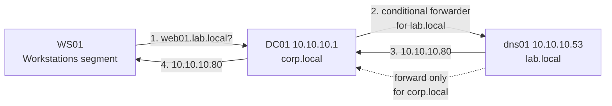

| Question | Asked to | What happens |
|---|---|---|
| `web01.lab.local` | `dns01` | Answered from its own `lab.local` zone file |
| `dc01.corp.local` | `dns01` | `dns01` forwards to DC01 and returns its answer |
| `web01.lab.local` | DC01 | DC01 forwards to `dns01` using a conditional forwarder |

## Build progress

- [x] Ubuntu Server template built, packages preinstalled, snapshot `template-ready`
- [x] `dns01`: static IP on the Servers segment, reachable from DC01
- [x] BIND9 configured: `lab.local` zone, `corp.local` forwarded to DC01
- [x] DC01 conditional forwarder for `lab.local`
- [x] Test from WS01 across segments (`web01.lab.local` and `dc01.corp.local` both resolve)
- [x] `dhcp01` with a DHCP relay agent on DC01 (test client received `10.10.20.101` through the relay)
- [x] `ntp01` with DC01 and `dns01` syncing time from it
- [x] `web01` serving a page, reached from WS01 by name (`web01.lab.local`)
- [x] Full write-up, screenshots and "Problems Encountered" section

## Build process

### 1. Ubuntu Server template

Building each Linux server from scratch would repeat the same install four times, so one template VM is built once and cloned. The template, `ubuntu-template`, runs Ubuntu Server 26.04 with 1 vCPU and 2 GB RAM. It was built on a **NAT** adapter, because package installs need internet and the lab segments have none. The packages for the planned roles (BIND9, chrony, Nginx) were installed there, and the role services were then **disabled**, so a clone only runs the one service it is meant for. With the VM powered off, a snapshot named `template-ready` was taken to clone from.


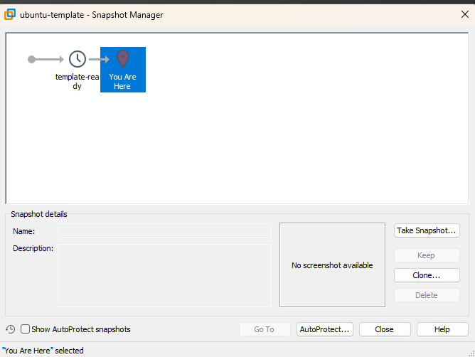

### 2. Clone `dns01` and put it on the Servers segment

`dns01` is a full clone of `template-ready`. A clone starts with the template's name and network settings, so it was given its own identity while still on NAT (so SSH kept working), then powered off before being moved to the lab network. The static address only works on VMnet2, so applying it on NAT would cut the connection.

```bash
sudo hostnamectl set-hostname dns01
sudo sed -i 's/<old-template-name>/dns01/g' /etc/hosts
```

The network config is in [`configs/dns01/50-cloud-init.yaml`](configs/dns01/50-cloud-init.yaml): static `10.10.10.53/24`, default gateway DC01 (`10.10.10.1`), DNS DC01. After powering off, the adapter was changed to **Custom: Servers - VMnet2** and memory to 1 GB.

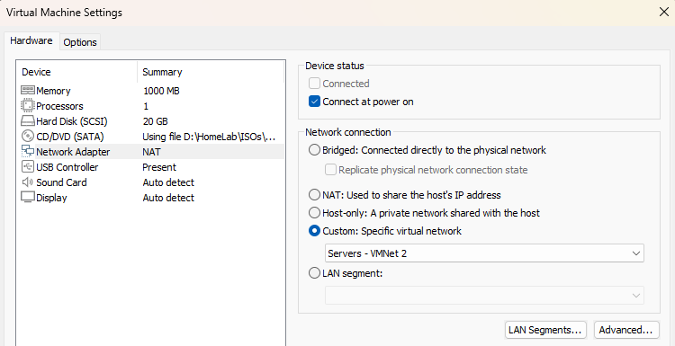

The clone booted with no IPv4 address because the installer's `00-installer-config.yaml` was still in `/etc/netplan` (see Problems below). It was moved aside and the config applied:

```bash
sudo mv /etc/netplan/00-installer-config.yaml /etc/netplan/00-installer-config.yaml.bak
sudo chmod 600 /etc/netplan/50-cloud-init.yaml
sudo netplan apply
ip -br a
ping -c 4 10.10.10.1
```

`dns01` shows `10.10.10.53/24` and reaches DC01 with 0% packet loss.


### 3. Configure BIND9 on `dns01`

**BIND9** is the DNS server software. `dns01` is the authoritative server for `lab.local` and forwards `corp.local` questions to DC01. Three files make that up (all in [`configs/dns01/`](configs/dns01/)):

- `named.conf.options` sets BIND to listen only on `10.10.10.53` and localhost, answer only the lab networks (`10.10.0.0/16`), and allow recursion for them only. DNSSEC validation is off because the lab has no internet to validate against.
- `named.conf.local` declares the zones: `lab.local` as `primary`, and `corp.local` as a `forward only` zone pointing at DC01 (`10.10.10.1`).
- `db.lab.local` holds the records: `dns01`, `dhcp01`, `ntp01` and `web01`. The records for servers not built yet are included so their names resolve as soon as they exist.

Both the configuration and the zone file were checked before starting the service. No output from `named-checkconf` means the syntax is valid:

```bash
sudo named-checkconf
sudo named-checkzone lab.local /etc/bind/db.lab.local
```

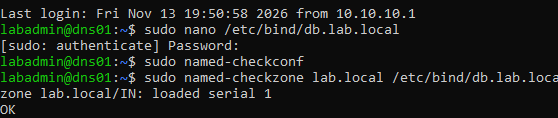

The service was disabled in the template, so it was enabled and started, then tested with `dig`. The first lookup is answered from the local zone, and the second is forwarded to DC01:

```bash
sudo systemctl enable --now named
dig @10.10.10.53 web01.lab.local +short
dig @10.10.10.53 dc01.corp.local +short
```

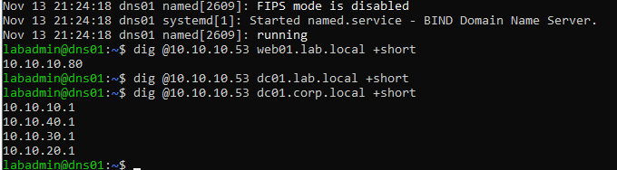

### 4. Make DC01 return a single address

The `dc01.corp.local` lookup returned four addresses (one per DC01 NIC), even though the Project 2 cleanup had removed them. Turning off DNS registration on the NICs was not enough: the **DNS Server service** itself registers every address it listens on. DC01's DNS server was restricted to listen only on its Servers address, then the stale records were checked after a service restart:

```powershell
dnscmd /ResetListenAddresses 10.10.10.1
Restart-Service DNS
Get-DnsServerSetting -All | Select-Object -ExpandProperty ListeningIPAddress
Get-DnsServerResourceRecord -ZoneName corp.local -Name DC01 -RRType A
```

Only `10.10.10.1` remains after a second restart.

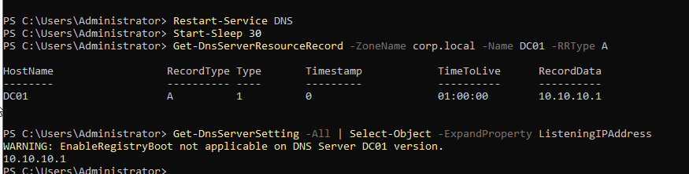

### 5. Conditional forwarder on DC01

The other direction: DC01 has to know where to send `lab.local` questions. A conditional forwarder tells DC01 "for names ending in `lab.local`, ask `dns01`". Without it Windows machines cannot find the Linux servers.

```powershell
Add-DnsServerConditionalForwarderZone -Name "lab.local" -MasterServers 10.10.10.53
Get-DnsServerZone -Name lab.local
Resolve-DnsName web01.lab.local -Server 10.10.10.1
```

`lab.local` shows as a `Forwarder` zone, and DC01 resolves `web01.lab.local` to `10.10.10.80` through `dns01`.


### 6. Test from WS01 across segments

WS01 sits on the Workstations segment, so this tests the whole chain: WS01 asks DC01, DC01 forwards to `dns01`, and the answer returns. WS01 first failed with a timeout, because it used DC01's Workstations address (`10.10.20.1`) for DNS, and DC01's DNS now only answers on `10.10.10.1`. WS01's DNS server was changed (this needs an elevated PowerShell):

```powershell
Set-DnsClientServerAddress -InterfaceAlias "Ethernet0" -ServerAddresses 10.10.10.1
Clear-DnsClientCache
Resolve-DnsName dc01.corp.local
Resolve-DnsName web01.lab.local
```

`dc01.corp.local` resolves to `10.10.10.1` and `web01.lab.local` to `10.10.10.80`.


### 7. DHCP server on `dhcp01`

**DHCP** hands out network settings (address, gateway, DNS server) automatically, so devices do not need to be configured by hand. `dhcp01` is another full clone of `template-ready`, built the same way as `dns01`: new hostname, the installer's `00-installer-config.yaml` moved aside, a static `10.10.10.67/24` ([`configs/dhcp01/50-cloud-init.yaml`](configs/dhcp01/50-cloud-init.yaml)) with `dns01` as its DNS server, then moved to **Servers - VMnet2** with 1 GB of RAM.

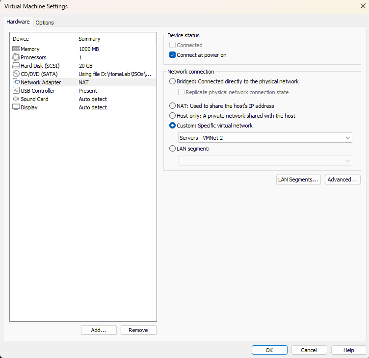
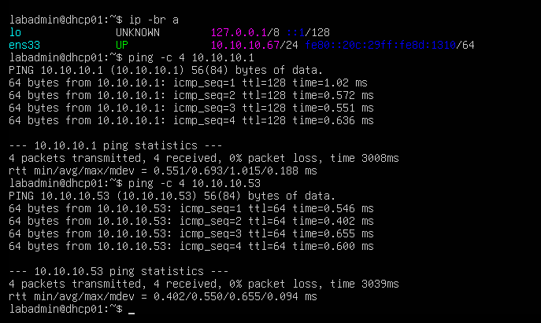

The scope is in [`configs/dhcp01/dhcpd.conf`](configs/dhcp01/dhcpd.conf):

- A pool of `10.10.20.100` to `10.10.20.200` for the Workstations segment (`10.10.20.0/24`), with `10.10.20.1` (DC01) as the gateway and `10.10.10.1` (DC01) as the DNS server. DC01 answers `corp.local` and forwards `lab.local` to `dns01`.
- Fixed addresses (such as WS01 at `10.10.20.50`) are kept **outside** the pool so the server can never hand one out twice.
- An **empty** block for `10.10.10.0/24`, the network `dhcp01` itself is on. The service only listens on a network card if the config describes that card's network. The block has no `range`, so no addresses are given out on the Servers segment.

The service listens on `ens33` (`INTERFACESv4="ens33"` in `/etc/default/isc-dhcp-server`). The config was checked before starting the service, then enabled and started:

```bash
sudo dhcpd -t -cf /etc/dhcp/dhcpd.conf
sudo systemctl enable --now isc-dhcp-server
systemctl status isc-dhcp-server --no-pager
```

The service log shows it listening on `ens33` for `10.10.10.0/24`.

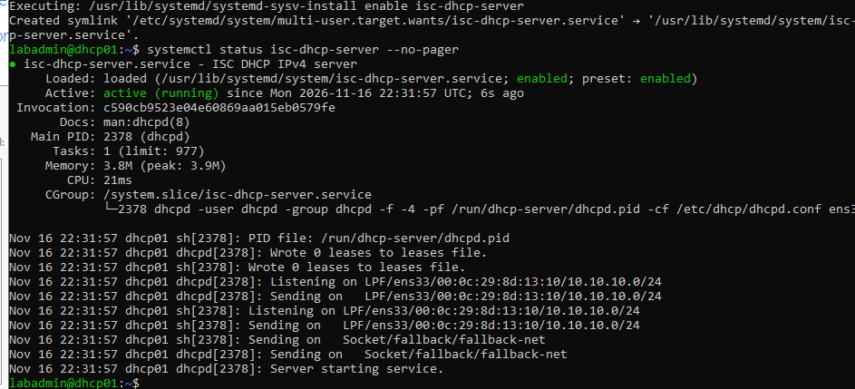

### 8. DHCP relay agent on DC01

A client asking for an address **broadcasts** its request on its own segment, and routers do not forward broadcasts. `dhcp01` is on the Servers segment, so it would never hear a request from the Workstations segment. The fix is the **DHCP Relay Agent** in Routing and Remote Access on DC01. It listens for the broadcast on the Workstations side and forwards it directly to `dhcp01`, noting which segment it came from so the server picks the matching scope.

In Routing and Remote Access on DC01: IPv4 > General > New Routing Protocol > **DHCP Relay Agent**, then:

1. DHCP Relay Agent > Properties > add the server address `10.10.10.67`.
2. DHCP Relay Agent > New Interface > **Workstations-VMnet3**, with Relay DHCP packets enabled.

The interface is the network card the relay listens on, so it has to be the one facing the clients.

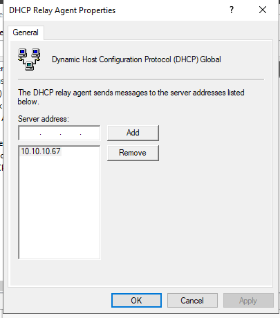
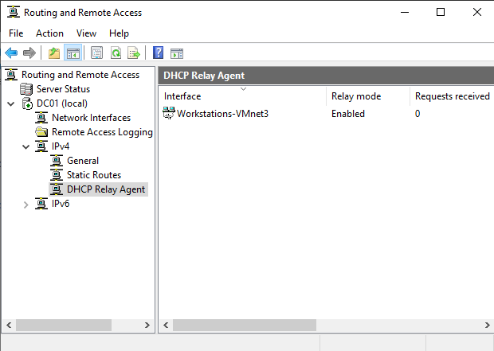

### 9. Test: a client on the Workstations segment gets a lease

`TestVM-Workstations` (Ubuntu, VMnet3) was used instead of WS01, which has a fixed address and is domain-joined. The test VM still had a fixed address from the Project 1 tests, so its netplan file was replaced with `dhcp4: true` ([`configs/testvm-workstation/00-installer-config.yaml`](configs/testvm-workstation/00-installer-config.yaml)) and applied with `sudo netplan apply`.

The VM received **`10.10.20.101/24`**, a default route via `10.10.20.1`, and DNS server `10.10.10.1`, all from the scope on `dhcp01`.

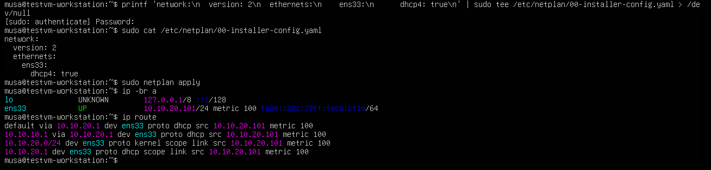

`resolvectl query web01.lab.local` on the client returns `10.10.10.80` with those settings, so the client can find the Linux servers by name (see the `.local` note in Problems below).

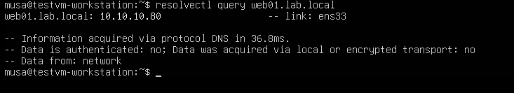

On `dhcp01` the journal shows the full four-step exchange, and the request arrives **via `10.10.20.1`**, the relay agent on DC01:

```bash
sudo journalctl -u isc-dhcp-server -n 20 --no-pager
```

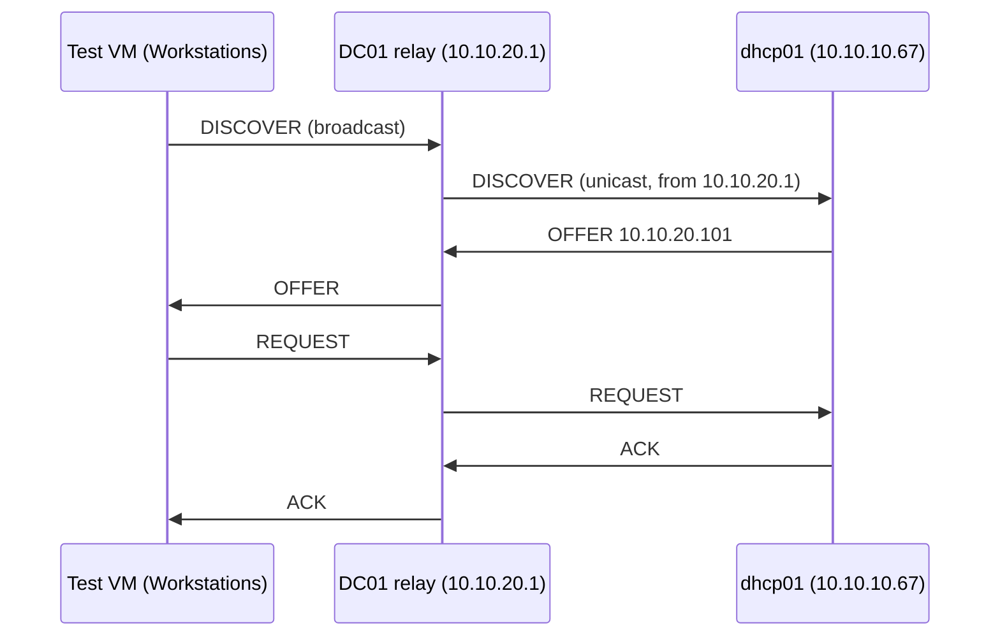

The last line in the screenshot is a `DHCPDISCOVER ... via ens33: no free leases` from `dns01`'s MAC address. It is expected: the Ubuntu early-boot environment asks for an address on every card before netplan's static config takes over, and the empty `10.10.10.0` block deliberately gives none.

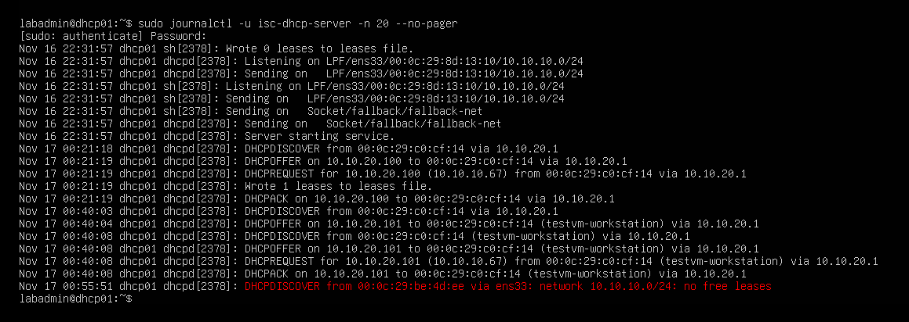

### 10. NTP server on `ntp01`

**Why:** Kerberos, which AD uses for sign-in, rejects a ticket when the two clocks differ by more than 5 minutes. A lab with no internet needs one internal time source. Time flows from `ntp01` to DC01 (the only domain controller), and from DC01 to domain members.

`ntp01` was cloned from the template the same way as the other servers (hostname, `/etc/hosts`, static `10.10.10.123/24` via [`configs/ntp01/50-cloud-init.yaml`](configs/ntp01/50-cloud-init.yaml), installer netplan file moved aside).

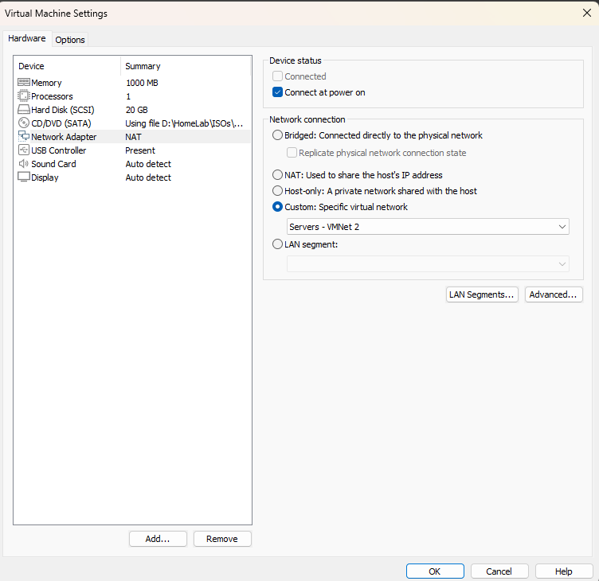

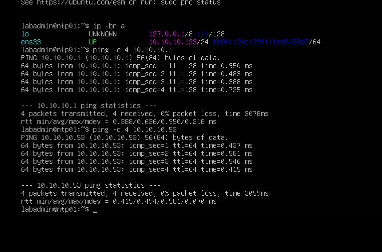

**Server:** `chrony` is configured in [`configs/ntp01/chrony.conf`](configs/ntp01/chrony.conf). `local stratum 10` makes it hand out its own clock as a reference with no upstream, and `allow 10.10.0.0/16` lets lab clients query it.

```bash
sudo systemctl restart chrony
chronyc tracking
```

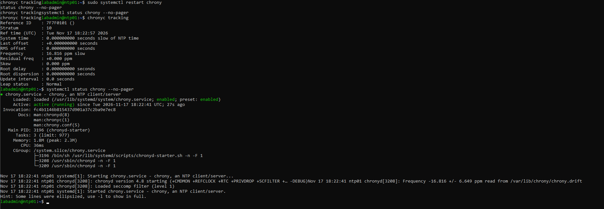

**DC01 (Windows time service)** is pointed at `ntp01` and marked reliable:

```powershell
w32tm /config /manualpeerlist:"10.10.10.123,0x8" /syncfromflags:manual /reliable:yes /update
Restart-Service w32time
w32tm /resync
w32tm /query /status
```

DC01 reports source `10.10.10.123`, stratum 11, and the stripchart shows offsets of about 0.0002 s. (The first `/resync` said "no time data available", which is normal for a service that has only just been restarted; the next query showed a good sync.)

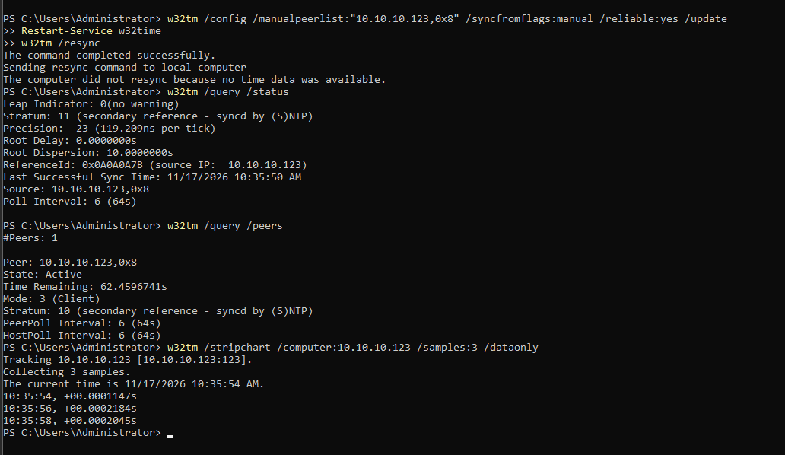

**`dns01` as a client** uses [`configs/dns01/chrony.conf`](configs/dns01/chrony.conf) (`server 10.10.10.123 iburst`). `chronyc sources -v` shows `^*` (selected source) against `10.10.10.123` and `chronyc tracking` shows stratum 11 and an offset of about 0.0001 s.

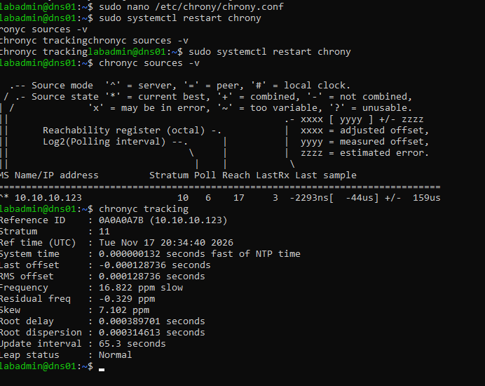

On `ntp01`, `sudo chronyc clients` lists both DC01 and `dns01`:

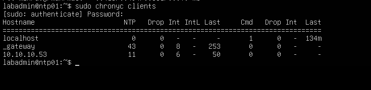

**Why stratum 11:** stratum counts hops from a reference clock. `ntp01` is 10, so anything syncing from it is 11, and a domain member syncing from DC01 would be 12.

### 11. Web server on `web01`

`web01` was cloned like the other servers (static `10.10.10.80/24` via [`configs/web01/50-cloud-init.yaml`](configs/web01/50-cloud-init.yaml)) with 1 GB of RAM on the Servers segment.

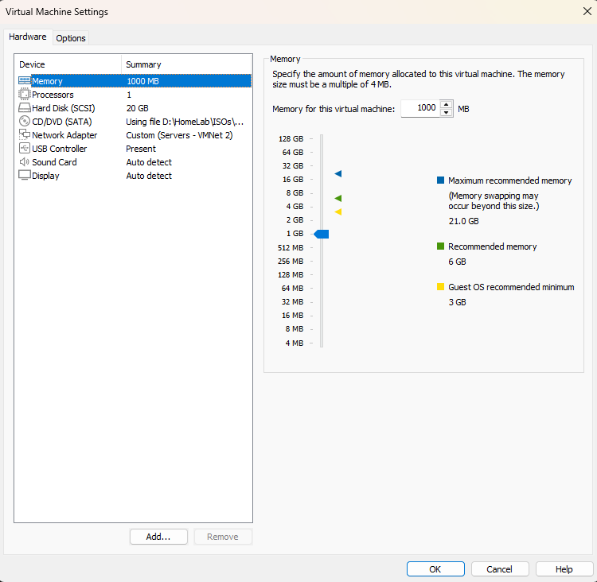

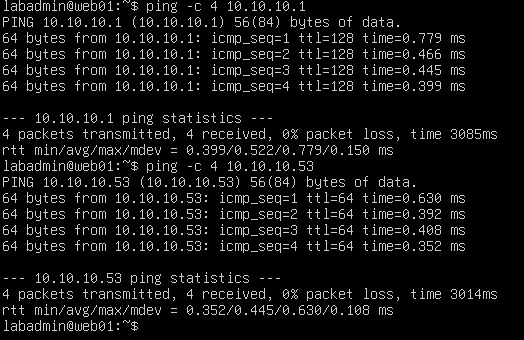

Nginx was installed in the template but disabled, so it was enabled and started, then the default page was replaced with one that names the server ([`configs/web01/index.html`](configs/web01/index.html)). Nginx serves `/var/www/html/index.html` by default.

```bash
sudo systemctl enable --now nginx
sudo nano /var/www/html/index.html
curl http://localhost
```

`curl` is a command-line web client: it sends an HTTP request and prints the reply. Here it proves Nginx works on the server itself.

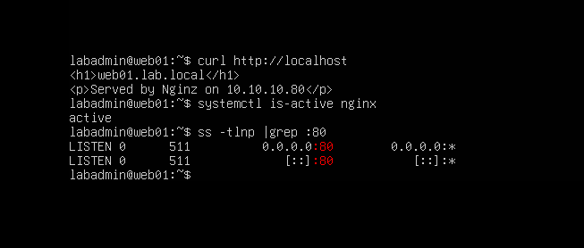

`web01` also syncs time from `ntp01` with the same client config as `dns01` ([`configs/web01/chrony.conf`](configs/web01/chrony.conf)); `chronyc sources -v` shows `^*` on `10.10.10.123`.

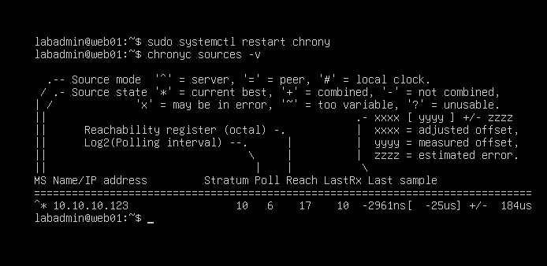

**Final test, from WS01 on another segment:**

```powershell
Resolve-DnsName web01.lab.local
curl.exe http://web01.lab.local
```

`curl.exe` is used because plain `curl` in PowerShell is an alias for `Invoke-WebRequest`. The name resolves to `10.10.10.80` and the page comes back across the router.

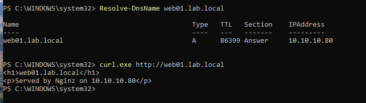

## How it all works together

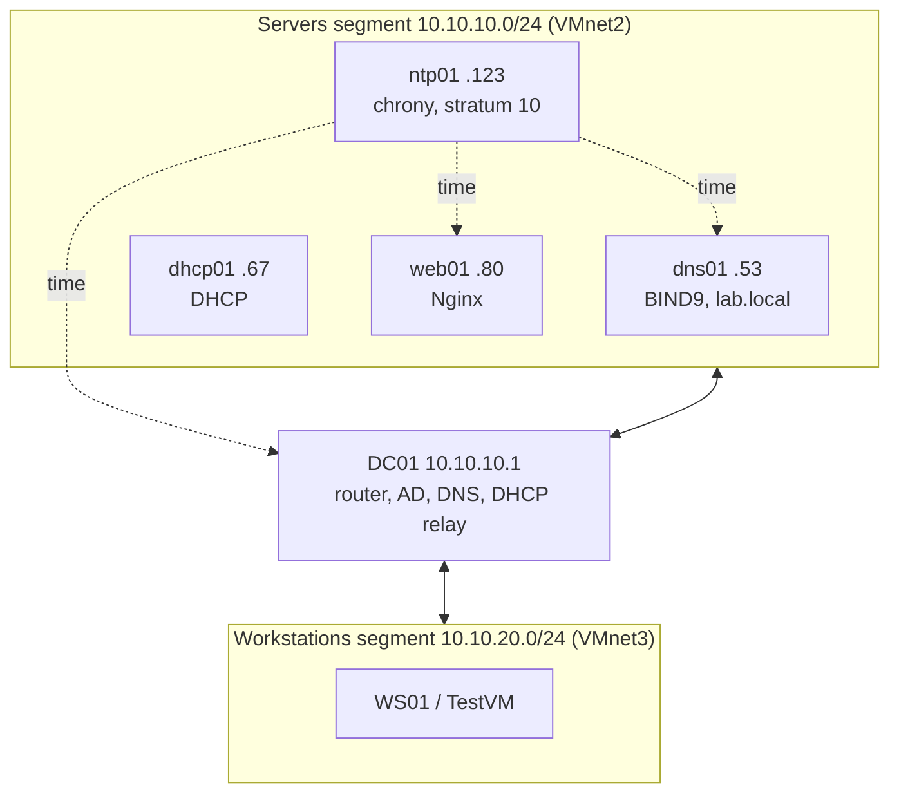

A new client on the Workstations segment uses every service in order:

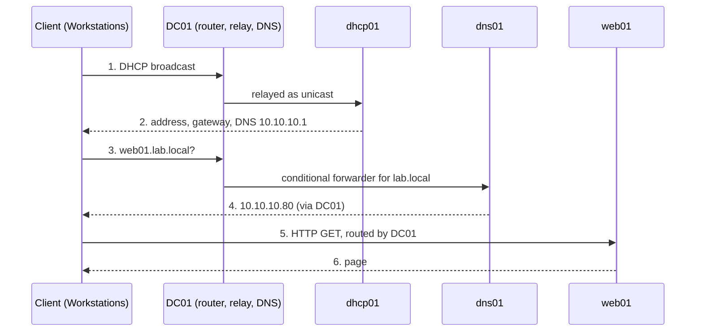

| Service | Provided by | Why it matters |
|---|---|---|
| Addresses | `dhcp01`, through the relay on DC01 | Broadcasts do not cross routers, so DC01 forwards them as unicast |
| Names | DC01 for `corp.local`, `dns01` for `lab.local` | Each server answers for its own domain and forwards the other |
| Routing | DC01 (RRAS) | Moves traffic between the Servers and Workstations segments |
| Time | `ntp01`, then DC01, then domain members | Kerberos fails if clocks differ by more than 5 minutes |
| Content | `web01` (Nginx) | Proves the whole chain works end to end |

## Problems Encountered & Fixes

| Problem | Cause | Fix |
|---|---|---|
| SSH to the template: "Connection refused" | `openssh-server` was not installed. Ubuntu 26.04 uses socket activation (`ssh.socket`), so `ssh.service` showing inactive is normal once it is installed | `sudo apt install -y openssh-server`, then retry |
| Clone still showed the template's name in `/etc/hosts` after `hostnamectl set-hostname dns01` | `hostnamectl` does not edit `/etc/hosts`, and the template name had been typed as `ubunutu-template`, so a `sed` for the correct spelling matched nothing | `cat /etc/hosts`, then `sudo sed -i 's/ubunutu-template/dns01/g' /etc/hosts`. Read the file before assuming a replacement worked |
| Netplan file came out with no indentation, capitalised keys and missing spaces | Typing a multi-line heredoc into the VMware console mangled the input. YAML is case- and indentation-sensitive | Wrote the file with a one-line `printf '...\n...' \| sudo tee`, pasted over SSH, then confirmed with `cat` before powering off |
| Pasted command failed with `/dev/null~: Permission denied` | Right-click paste into Windows PowerShell appended a stray `~` (bracketed-paste artefact) | Press Backspace once to remove the `~` before Enter. Later config files were typed in `nano` over SSH from DC01 |
| Clone booted on VMnet2 with no IPv4 address although `50-cloud-init.yaml` held the correct static config | A second file, `00-installer-config.yaml`, set `ens33` to DHCP and matched the template's MAC address. Netplan merges all files, so the merged definition never matched the clone's NIC. cloud-init was disabled and was not the cause | Diagnosed with `ls /etc/netplan`, `sudo cat /etc/netplan/*.yaml` and `cloud-init status`. Moved the installer file aside, `chmod 600` on the remaining file, `sudo netplan apply`. Verified `10.10.10.53/24` and a ping to DC01 |
| `dc01.corp.local` returned four IPs when queried through `dns01` | DC01's DNS Server service re-registered every NIC's address after the Project 2 cleanup, even with NIC registration off | Restricted the DNS server to listen only on `10.10.10.1` (`dnscmd /ResetListenAddresses 10.10.10.1`, restart DNS) and confirmed only `10.10.10.1` remained after a second restart |
| WS01 lookups timed out right after that change | WS01's DNS server was DC01's Workstations address (`10.10.20.1`), which DC01's DNS stopped answering on | `Get-DnsClientServerAddress` on WS01 showed it. Pointed WS01 at `10.10.10.1` with `Set-DnsClientServerAddress -InterfaceAlias "Ethernet0" -ServerAddresses 10.10.10.1` |
| `Set-DnsClientServerAddress` failed with "Access to a CIM resource was not available" | PowerShell was not elevated; WS01 was signed in as a standard user | Opened PowerShell as administrator and supplied `CORP\Administrator` credentials |
| `resolvectl query web01.lab.local` on Ubuntu failed with "No appropriate name servers or networks for name found" | `systemd-resolved` treats `*.local` as multicast DNS, which is off on the card, so it never asks the unicast DNS server DHCP gave it. Windows clients are unaffected. It is also one reason `.local` is discouraged for AD domains | `sudo resolvectl domain ens33 '~local'` routes `.local` names to the card's DNS server (runtime only) |
| The same lookup then returned `SERVFAIL` | DC01 forwards `lab.local` to `dns01`, and `dns01` was powered off | Powered on `dns01`, and the lookup returned `10.10.10.80`. Every server in a forwarding chain has to be up |
| `dhcp01` logged `DHCPDISCOVER ... via ens33: no free leases` from `dns01`'s MAC | Ubuntu's early-boot network config (`/run/systemd/network/zzzz-dracut-default.network`, `DHCP=yes`) asks for an address before netplan's static config applies. The empty `10.10.10.0` block gives none | Expected and harmless. Found with `sudo grep -ri dhcp /etc/netplan /run/systemd/network/` |
| Test VM was not asking for DHCP | Its netplan file still held the fixed address from the Project 1 tests | Replaced it with `dhcp4: true` and ran `sudo netplan apply` |
| `ntp01` clone and `web01` clone kept the template's name in `/etc/hosts` | The template's name had been typed as `ubunutu-template`, so a `sed` using the correct spelling matched nothing (same cause as `dns01`) | Used the exact spelling from `cat /etc/hosts`. The terminal prompt keeps the old name until the next login |
| First `w32tm /resync` on DC01 said "no time data was available" | The time service had only just been restarted and had not polled `ntp01` yet | Waited a moment and re-ran `w32tm /query /status`: source `10.10.10.123`, stratum 11 |

Notes:
- Do not run `netplan apply` while the VM is on NAT. The static `10.10.10.x` address only works on VMnet2 and it cuts the SSH session. Write the file, power off, switch the adapter, then boot.
- Every clone from `template-ready` carries the installer's `00-installer-config.yaml`. Move it aside on each clone before setting the static IP.

